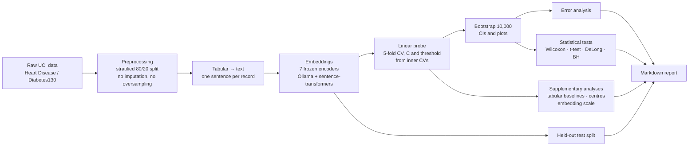

# Forecast — Semantic Embeddings for Clinical Classification using Local Language Models

Forecast is the experimental pipeline of a thesis on clinical classification with locally run language models. Every structured clinical record is converted into an English sentence, encoded by a frozen text encoder running on the local machine, and classified by a linear probe (standardized embeddings + L2 logistic regression). Seven encoders from three families are compared on two clinical tasks, with nested cross-validation, a held-out test split, bootstrap confidence intervals, paired statistical tests and tabular baselines.



## Research questions

- **RQ1.** Do semantic embeddings generated locally by language models effectively support clinical classification, starting from structured data converted into natural language?
- **RQ2.** Do encoders specialized for the biomedical domain produce more effective representations than general-purpose ones for this task?

## Main results

| | Heart Disease | Diabetes130 |
|---|---|---|
| ROC-AUC of the 7 encoders, 5-fold CV | 0.849–0.890 | 0.600–0.609 |
| ROC-AUC of the 7 encoders, test split | 0.889–0.925 | 0.605–0.622 |
| Tabular logistic regression (CV / test) | 0.896 / 0.914 | 0.618 / 0.644 |
| Mean AUC, biomedical vs general-purpose (CV) | 0.882 vs 0.870 | 0.605 vs 0.603 |
| Significant DeLong comparisons (BH-corrected) | 9 of 21 (5 of 12 across families) | 0 of 21 |

On Heart Disease the best encoder (PubMedBERT) matches a logistic regression on the original columns; on Diabetes130 every approach has weak signal and the text representation loses one to two AUC points. The biomedical advantage is small, task-dependent, and was overstated when embeddings were not standardized: 3.8 instead of 1.2 points on Heart Disease, 8.6 instead of 0.3 on Diabetes130, where two general-purpose encoders fell to chance level; see `embedding_scale.csv` (phase 8). Full numbers and interpretation are in `datas/<dataset>/reports/report.md` and in the study manual (`manuale_v3/`).

## Datasets

| Dataset | `--dataset` | Records | Features | Target | Positives |
|---|---|---|---|---|---|
| UCI Heart Disease (4 centres) | `heart_disease` (default) | 920 (736 train / 184 test) | 13 clinical | coronary artery disease (`num > 0`) | 55% |
| Diabetes 130-US Hospitals | `diabetes130` | 20,000 sampled from 69,990 first encounters (16,000 / 4,000) | 19 administrative and clinical | readmission within 30 days | 9% |

Origin, cleaning, variables, missing values and limitations: **[docs/DATASET.md](docs/DATASET.md)**.

## Encoders

| Family | Pipeline label → actual model | Backend |
|---|---|---|
| General-purpose | `e5-base` → intfloat/e5-base-v2 (q8_0); `gte-base` → M3E-base; `gte-large` → GTE-large-zh; `e5-large` → multilingual-e5-large-instruct (q8_0) | Ollama |
| Biomedical | `bioclinicalbert` → emilyalsentzer/Bio_ClinicalBERT; `pubmedbert` → NeuML/pubmedbert-base-embeddings | sentence-transformers |
| Biomedical sentence-transformer | `sentence-biobert` → pritamdeka/BioBERT-mnli-snli-scinli-scitail-mednli-stsb | sentence-transformers |

Three labels do not match the model behind them (`gte-base`, `gte-large`, `e5-large`): use the actual model names when reporting results. The configuration is in `models_ollama` / `models_medical` in [function.py](function.py).

## Repository structure

```
Forecast/
├── main.py                  # runs the 9 phases for one dataset
├── function.py              # configuration, data loading, linear probe, output folders, plots
├── preprocessing.py         # phase 1: stratified split, visualization-only imputed copy
├── embedding.py             # phase 2: record → sentence, embeddings via Ollama / sentence-transformers
├── classification.py        # phase 3: 5-fold CV with nested choice of C and threshold
├── evaluation.py            # phase 4: bootstrap CIs and plots
├── error_analysis.py        # phase 5: false positives/negatives, hardest cases, feature deviation
├── statisticaltest.py       # phase 6: Wilcoxon, paired t-test, DeLong, Benjamini-Hochberg
├── holdout_evaluation.py    # phase 7: one measurement on the held-out test split
├── supplementary_analysis.py # phase 8: tabular baselines, per-centre AUC, embedding-scale sensitivity
├── generatereport.py        # phase 9: datas/<dataset>/reports/report.md
├── tests/                   # unit tests (no network, no Ollama)
├── datasets/                # raw UCI files
├── datas/<dataset>/         # outputs: preprocessing, embeddings, results, graphics, reports
├── docs/                    # dataset, statistical tests, change log
├── manuale_v3/              # study manual (Italian): chapters, figures, EPUB/HTML build
└── run_pipeline.sh/.bat/.ps1  # environment setup + Ollama models + main.py (macOS/Linux, Windows cmd, PowerShell)
```

## Method in brief

| Step | What happens | Why |
|---|---|---|
| Split | Stratified 80/20, seed 42, before anything else | The test split never influences any choice |
| Missing values | Not imputed: written as `not recorded` in the sentence | No invented values in the text; the effect of informative missingness is measured separately |
| Class imbalance | No oversampling; handled by the decision threshold | Oversampling before CV caused leakage (Diabetes130 CV AUC 0.76 vs 0.55 real) and distorts probabilities |
| Text | One sentence per record, codes translated to words, units added | Lets the encoder use its language knowledge |
| Embeddings | 7 frozen encoders, max 512 tokens | No truncation; same input for every encoder |
| Classifier | `StandardScaler` + L2 `LogisticRegression` | Linear probe; standardization makes Ollama (unit-norm) and Hugging Face (norm 11–13) vectors comparable |
| C | Chosen per encoder in {0.001 … 100} by inner 5-fold CV (ROC-AUC) | One fixed C favoured one family |
| Threshold | F1-optimal on out-of-fold scores of an inner 5-fold CV | Never chosen on the labels it is evaluated on |
| Validation | Outer stratified 5-fold CV; then the same protocol on the whole training split, measured once on the test split | Stable estimates plus an independent check |
| Uncertainty | 10,000 paired bootstrap resamples of the out-of-fold predictions, percentile 95% CIs | Same resampled patients for every encoder |
| Tests | Wilcoxon and paired t-test on the bootstrap values; DeLong on out-of-fold AUCs; Benjamini-Hochberg | See [docs/STATISTICAL_TESTS.md](docs/STATISTICAL_TESTS.md) |

## Supplementary analyses (phase 8)

Run by `main.py` after the holdout phase, with the same splits, folds and seed:

- **Tabular baselines** (`tabular_baselines.csv`): logistic regression and gradient boosting on the original columns, same CV and threshold protocol as the encoders. They tell whether the text representation keeps, adds or loses information.
- **Per-centre analysis** (Heart Disease only, `centre_analysis.csv`, `non_clinical_signal.csv`): encoder AUC computed inside each source centre, and AUC of the centre prevalence alone and of missingness indicators alone.
- **Embedding-scale sensitivity** (`embedding_scale.csv`, `embedding_scale_delong.csv`): encoder comparison under four probing protocols (raw vectors with C=1, standardized with C=1, unit-normalized with C=1, standardized with CV-chosen C) and DeLong tests under the last one. With raw vectors and C=1 the general-purpose encoders, whose vectors have unit norm, are over-regularized: the family gap is 3.8 AUC points on Heart Disease and 8.6 on Diabetes130; under the standardized, CV-tuned protocol it is 1.0 and 0.3 points, with 8/21 and 0/21 significant DeLong comparisons.

## Prerequisites

- **Python 3.14** (developed and tested on this version), on Apple Silicon macOS; other platforms should work but are not verified.
- **Ollama**, installed and running, for the four general-purpose encoders: [ollama.com](https://ollama.com).
- **Hugging Face access** for the three biomedical encoders (downloaded once by sentence-transformers).
- No GPU needed. About 8 GB of free RAM is enough. A full Diabetes130 run takes from about 1.5 to 3 hours, dominated by embedding 20,000 sentences with seven encoders; the supplementary analyses (phase 8) add about 15 minutes. Heart Disease takes minutes after the embeddings.

## Installation

```bash
python3 -m venv env
source env/bin/activate
pip install -r requirements.txt

ollama serve &
ollama pull jeffh/intfloat-e5-base-v2:q8_0
ollama pull twwch/m3e-base
ollama pull zyw0605688/gte-large-zh
ollama pull jeffh/intfloat-multilingual-e5-large-instruct:q8_0
```

Create a `.env` file in the project root:

```
HF_READ_TOKEN=your_token_here
OFFLINE_MODE=0
```

`HF_READ_TOKEN` is optional (needed only for gated models or rate limits); set `OFFLINE_MODE=1` after the first download to use only the local model cache.

## Running

```bash
source env/bin/activate
python main.py --dataset heart_disease
python main.py --dataset diabetes130
python -m pytest -q
```

`--dataset` defaults to `heart_disease`. Each run deletes and regenerates only its own `datas/<dataset>/` tree. `run_pipeline.sh` (`run_pipeline.bat` or `run_pipeline.ps1` on Windows) also creates the virtual environment, installs the requirements, starts Ollama, pulls the models and forwards its arguments to `main.py`:

```bash
./run_pipeline.sh --dataset diabetes130
```

Every random step uses seed 42: rerunning gives identical results (verified on both datasets in November 2026).

## Outputs (`datas/<dataset>/`)

| Folder | Contents |
|---|---|
| `preprocessing/` | `X_train_raw.csv`, `X_test_raw.csv` (raw records, missing values as empty cells), `y_test.npy` |
| `embeddings/` | `*_embeddings.npy` (training) and `*_embeddings_test.npy` (test split), with labels |
| `results/` | Out-of-fold predictions, bootstrap arrays, `encoder_comparison_summary.csv` (means and 95% CIs), `model_performance.csv` (per-fold means, PR-AUC, Brier, threshold, C), `holdout_evaluation.csv`, `{wilcoxon,ttest,delong}_comparison.csv`, error-analysis CSVs, supplementary-analysis CSVs (`tabular_baselines`, `centre_analysis`, `non_clinical_signal`, `embedding_scale`, `embedding_scale_delong`), plots |
| `graphics/` | UMAP, correlation heatmap, ROC comparison, confusion matrices (PNG and PDF) |
| `reports/` | `report.md` |

## Study manual

`manuale_v3/` contains a study manual in Italian: background from scratch (machine learning, statistics, language models), method, results, limitations, likely discussion questions and bibliography. Build it with:

```bash
pip install markdown latex2mathml pandas   # not part of requirements.txt
python manuale_v3/genera_figure.py
python manuale_v3/build_epub.py            # writes the .epub and a single-file .html
```

## Troubleshooting

- **Apple Silicon**: check that Python runs natively (`python3 -c "import platform; print(platform.machine())"` prints `arm64`); a Rosetta Python makes `torch`/`numba` installs slow or failing.
- **Ollama model not found**: pull the four models above and check with `ollama list`.
- **Hugging Face errors**: set `HF_READ_TOKEN` in `.env`; use `OFFLINE_MODE=1` only after the models are cached.
- **`FileNotFoundError` in `datas/...`**: an earlier phase did not complete; rerun `main.py` for that dataset.
- **`ModuleNotFoundError`**: run `pip install -r requirements.txt` inside the activated environment.

## Further documentation

- [docs/DATASET.md](docs/DATASET.md): datasets, cleaning, variables, missing values, limitations
- [docs/STATISTICAL_TESTS.md](docs/STATISTICAL_TESTS.md): bootstrap, Wilcoxon, paired t-test, DeLong, Benjamini-Hochberg, and how to read them
- [docs/CHANGES.md](docs/CHANGES.md): methodological corrections and their measured effect
