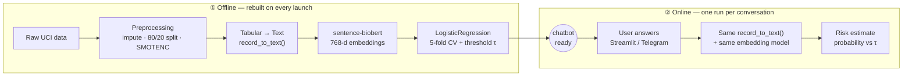

# Forecast — Clinical Risk Chatbot

A conversational agent that walks a user through a short clinical questionnaire and returns a
**risk estimate** for one of two UCI benchmarks: **Heart Disease** (is coronary disease present?)
and **Diabetes 130-US Hospitals** (will this patient be readmitted within 30 days?).

The dialogue itself is deterministic — a fixed sequence of validated questions — but the final
answer is not a hand-written rule: it comes from a classifier trained on real clinical records,
where each record is first rewritten as a natural-language sentence and embedded with a
**biomedical sentence-transformer**.



---

## Table of contents

- [How it works](#how-it-works)
- [Example conversation](#example-conversation)
- [Architecture](#architecture)
- [The two datasets](#the-two-datasets)
- [Which dataset should I run?](#which-dataset-should-i-run)
- [Results](#results)
- [The pipeline in detail](#the-pipeline-in-detail)
- [Prerequisites](#prerequisites)
- [Installation](#installation)
- [Usage](#usage)
- [Repository structure](#repository-structure)
- [Generated data](#generated-data)
- [Key libraries](#key-libraries)
- [Troubleshooting](#troubleshooting)
- [Limitations and disclaimer](#limitations-and-disclaimer)
- [References](#references)

---

## How it works

The system is a **task-oriented chatbot**: it has exactly one goal, and the conversation exists
only to collect the inputs that goal needs.

**The dialogue is slot-filling.** Each dataset defines an ordered list of questions — one per
clinical feature. Every question declares four things: the `field` it fills, the `prompt` shown
to the user, a `parser` that validates and converts the answer, and the `error` message to repeat
when parsing fails. The agent never advances past a slot it could not interpret.

**The decision is learned.** Once every slot is filled, the collected answers are turned into a
sentence by the same `record_to_text_*()` function used during training, embedded with the same
model, and scored by the trained classifier. The resulting probability is compared against a
decision threshold **τ** that was itself learned from the data (not fixed at 0.5).

This split matters: the conversation is predictable and auditable, while the part that actually
makes a judgement is measurable (see [Results](#results)).

**Only one encoder is used.** Across an earlier comparison of general-purpose and biomedical
encoders on both datasets, the biomedical sentence-transformer **`sentence-biobert`**
(`pritamdeka/BioBERT-mnli-snli-scinli-scitail-mednli-stsb`) scored highest on ROC-AUC, so it is
hardcoded as the single encoder in [`function.py`](function.py)'s `EMBEDDING_MODEL`.

---

## Example conversation

```
🤖  Ciao! Sono un assistente che stima il rischio clinico in base ad alcuni dati di base.
    ⚠️ Non sono uno strumento diagnostico: per qualsiasi dubbio consulta un medico.

    Sei uomo o donna? (rispondi 'uomo' o 'donna')
👤  uomo
🤖  Quanti anni hai?
👤  centoventi
🤖  Inserisci un'età valida (un numero tra 1 e 120).      ← slot not advanced
👤  63
🤖  Che tipo di dolore al petto avverti?
    1) angina tipica   2) angina atipica
    3) dolore non anginoso   4) asintomatico
👤  1
    … 10 more questions …
🤖  In base ai dati forniti, il paziente risulta a RISCHIO di malattia cardiaca.
    Probabilità stimata: 78.4% (soglia di decisione: 39.0%).

    ⚠️ Questo è solo un supporto informativo basato su un modello statistico,
    non una diagnosi medica. Consulta sempre un professionista sanitario.

    Scrivi 'nuovo' per fare un'altra valutazione.
```

Typing `nuovo`, `ricomincia`, `restart` or `/start` resets the session at any point.

---

## Architecture

| Module | Responsibility |
|---|---|
| [`main.py`](main.py) | Entry point. Rebuilds the classifier for the chosen dataset, then launches the chosen front-end. |
| [`function.py`](function.py) | Single source of configuration: `EMBEDDING_MODEL`, column lists per dataset, raw-data loaders, per-dataset output paths, folder cleanup. |
| [`preprocessing.py`](preprocessing.py) | Raw records → imputed, split and class-balanced training set. |
| [`embedding.py`](embedding.py) | `record_to_text_*()` (tabular → sentence) and embedding generation. |
| [`classification.py`](classification.py) | 5-fold stratified cross-validation, metrics, F1-optimal threshold → `model_performance.csv`. |
| [`chatbot_core.py`](chatbot_core.py) | The agent itself: question lists, session state, answer parsing, prediction. **Front-end agnostic.** |
| [`app_streamlit.py`](app_streamlit.py) | Streamlit chat UI. |
| [`bot_telegram.py`](bot_telegram.py) | Telegram bot (async, polling, one session per `chat_id`). |

Both front-ends are thin: they receive text, hand it to `chatbot_core.handle_message()`, and
display the reply. Neither contains dialogue or prediction logic, so switching channel does not
change the agent's behaviour.

**Conversation state** lives in `ConversationSession` — the answers collected so far plus the
index of the current question. Telegram keeps one session per `chat_id`, so multiple users can
talk to the bot concurrently; Streamlit keeps it in `st.session_state`.

---

## The two datasets

### ❤️ UCI Heart Disease — *diagnosis*

Does this patient have coronary artery disease, based on a single cardiology visit?

| | |
|---|---|
| **Raw records** | **920**, concatenated from four clinical centres |
| | Cleveland Clinic Foundation — 303 · Hungarian Institute of Cardiology — 294 |
| | University Hospital Zurich/Basel — 123 · V.A. Medical Center Long Beach — 200 |
| **Features used** | **13** — age, sex, chest pain type, resting blood pressure, serum cholesterol, fasting blood sugar, resting ECG, max heart rate, exercise-induced angina, ST depression, ST slope, major vessels by fluoroscopy, thalassemia |
| **Target** | `num > 0` → disease present (the original 1–4 severity grading is binarised) |
| **After balancing** | **814** records (407 / 407) |
| **Questions asked** | 13 |

A dataset-specific cleanup: in some centres a missing cholesterol or blood-pressure reading is
recorded as `0`. Since neither value is physiologically possible, `load_heart_disease()` converts
those zeros to missing values so they are imputed like any other gap.

### 🏥 UCI Diabetes 130-US Hospitals — *prognosis*

Will this diabetic patient be readmitted within 30 days of discharge?

| | |
|---|---|
| **Raw records** | **101,766** hospital encounters, 130 US hospitals, 1999–2008 |
| **Sampled** | **20,000** (stratified, `random_state=42`) to keep build time manageable |
| **Features used** | **19** of ~50 — demographics, admission/discharge/source IDs, length of stay, counts of lab procedures, procedures and medications, prior outpatient/emergency/inpatient visits, number of diagnoses, max glucose serum, A1C result, insulin therapy, medication change, diabetes medication |
| **Target** | `readmitted == "<30"` → early readmission (later readmissions and non-readmissions are both negative) |
| **After balancing** | **28,428** records (14,214 / 14,214) |
| **Questions asked** | 19 |

Columns excluded from the raw file are the near-constant drug-dosage flags (e.g. `examide`,
`citoglipton`) and the high-missingness or non-clinical identifiers (`weight`, `payer_code`,
`patient_nbr`).

---

## Which dataset should I run?

| Criterion | Heart Disease | Diabetes 130 |
|---|---|---|
| Task | Diagnosis | 30-day readmission prognosis |
| Raw records | 920 | 101,766 |
| Records used for training | 814 | 28,428 |
| Features / questions | 13 | 19 |
| Nature of the questions | Clinical and instrumental | Mostly administrative |
| Build time | Minutes | Substantially longer |
| ROC-AUC | **0.877** | 0.768 |

**Choose by:**

- **What you want to demonstrate** — detecting existing disease, or predicting a future event.
- **Who answers the questions** — Heart Disease asks for values that require a specialist exam
  (exercise ECG, fluoroscopy); Diabetes 130 asks for data a hospital clerk would have at hand.
- **How much time you have** — 814 embeddings versus 28,428 is the dominant cost of a launch.

For a quick demo, **`heart_disease`** is the practical choice: it builds in minutes and performs
noticeably better.

---

## Results

Mean across the 5 stratified cross-validation folds, as written to
`datas/<dataset>/results/model_performance.csv`:

| Dataset | Accuracy | Macro-F1 | ROC-AUC | Threshold τ |
|---|---|---|---|---|
| **Heart Disease** | 0.8206 | 0.8193 | **0.8772** | 0.3904 |
| **Diabetes 130** | 0.6831 | 0.6714 | 0.7679 | 0.3757 |

**Reading these numbers.** ROC-AUC is the reference metric because it is independent of the
threshold: it measures how well the model *ranks* patients by risk. Accuracy and macro-F1 are
computed at the learned τ, and are measured on the SMOTENC-balanced pool — not on the original
class distribution.

The gap between the two datasets is consistent across all three metrics and reflects the
difficulty of the task: predicting a future readmission depends on factors the dataset does not
contain (treatment adherence, home support, socio-economic conditions), while diagnosing coronary
disease from direct clinical measurements is a much more closely determined problem.

---

## The pipeline in detail

### 1. Preprocessing — [`preprocessing.py`](preprocessing.py)

1. **Load** the raw dataset (`load_heart_disease()` or `load_diabetes130()`).
2. **Binarise** the target (`y > 0`).
3. **Stratified 80/20 split** (`random_state=42`) so class proportions are preserved.
4. **Impute** missing values on the raw feature space: median for numeric columns, mode for
   categorical ones. This runs *before* balancing, because SMOTENC and the text conversion both
   need complete records.
5. **Balance** with **SMOTENC** (`random_state=42`).

> **Why SMOTENC and not plain SMOTE?** SMOTE operates in an encoded numeric space, and the
> synthetic rows it produces cannot be mapped back to a meaningful clinical record. SMOTENC
> handles numeric and categorical columns together — interpolating the numbers, assigning each
> categorical field the majority value among the nearest neighbours — so every synthetic row
> remains a *valid clinical record* that `record_to_text_*()` can describe in words, exactly like
> a real one.

The balanced raw features are also saved to `preprocessing/X_train_raw.csv`, row-aligned with the
embeddings, so a prediction can be traced back to the record that produced it.

### 2. Tabular → text → embedding — [`embedding.py`](embedding.py)

Each record becomes one English sentence:

```
Male patient, 63 years old, chest pain type: angina tipica,
resting blood pressure: 145 mm Hg, serum cholesterol: 233 mg/dl,
fasting blood sugar > 120 mg/dl: yes, resting electrocardiographic results: normale,
maximum heart rate achieved: 150, exercise-induced angina: no,
ST depression induced by exercise: 2.3, slope of the peak exercise ST segment: discendente,
number of major vessels colored by fluoroscopy: 0, thalassemia: difetto fisso
```

Coded attributes are expanded into their clinical labels (`CP_LABELS`, `RESTECG_LABELS`,
`SLOPE_LABELS`, `THAL_LABELS`) rather than left as bare integers, so the encoder sees terms it has
actually met in biomedical literature. Missing values become `not recorded`.

The sentences are then embedded into **768-dimensional** vectors and saved as `.npy`.

### 3. Classification — [`classification.py`](classification.py)

`StratifiedKFold(n_splits=5, shuffle=True, random_state=42)` over the embeddings. For each fold:

1. Fit `LogisticRegression(max_iter=2000)` on the training folds.
2. Score the held-out fold with `predict_proba()`.
3. Compute the precision-recall curve and pick the **τ that maximises F1**.
4. Record accuracy, macro-F1, ROC-AUC and τ.

The reported values are the mean of the five folds.

> **Why a linear model?** The embedding has already done the semantic work; a linear probe on
> frozen representations measures how much signal is already present in the vector, with far
> fewer parameters to estimate — which matters on Heart Disease, where there are 814 records and
> 768 dimensions.

> **Why not threshold at 0.5?** Both learned thresholds sit near 0.38–0.39, meaning the system
> flags "at risk" well below an even split. In a clinical screening context a false negative
> costs more than a false alarm, and the F1-optimal threshold reflects that asymmetry.

### 4. Serving — [`chatbot_core.py`](chatbot_core.py)

`_load_deployed_bundle()` reads the saved threshold from `model_performance.csv` and refits a
`LogisticRegression` on **all** available embeddings (not just 4/5 of them, as in each CV fold),
caching the result in memory for the process. `_ensure_embedder()` loads the sentence-transformer
once. From then on, each completed conversation costs one `record_to_text()`, one `encode()` and
one `predict_proba()`.

---

## Prerequisites

- **Python 3.11+** (developed and tested on 3.14.0)
- **Internet access on first run** — the `sentence-biobert` model (~830 MB on disk) is downloaded
  automatically by `sentence-transformers` and cached locally afterwards. No local model server
  (Ollama or similar) is required.
- **A Telegram bot token** — only if you use the Telegram front-end. Create one via
  [@BotFather](https://t.me/BotFather).

---

## Installation

```bash
python3 -m venv env
source env/bin/activate          # Windows: env\Scripts\activate
pip install -r requirements.txt
```

For the Telegram bot, create a `.env` file in the project root:

```
TELEGRAM_BOT_TOKEN=your-token-here
```

`.env` is git-ignored and never committed.

---

## Usage

### Option A — one command, guided

`run_chatbot.sh` (macOS/Linux), `run_chatbot.bat` (Windows cmd) and `run_chatbot.ps1`
(PowerShell) create and activate `env/`, install the dependencies, then ask which dataset and
which front-end to use — or accept both as flags:

```bash
./run_chatbot.sh                                              # interactive prompts
./run_chatbot.sh --dataset heart_disease --chatbot streamlit
./run_chatbot.sh --dataset diabetes130  --chatbot telegram
```

```powershell
.\run_chatbot.ps1
.\run_chatbot.ps1 -Dataset heart_disease -Chatbot streamlit
```

```bat
run_chatbot.bat
run_chatbot.bat --dataset heart_disease --chatbot streamlit
```

The script warns you if you pick Telegram without a token configured.

### Option B — manual

```bash
python main.py --dataset heart_disease --chatbot streamlit
python main.py --dataset diabetes130  --chatbot telegram
```

| Flag | Values | Default |
|---|---|---|
| `--dataset` | `heart_disease`, `diabetes130` | `heart_disease` |
| `--chatbot` | `streamlit`, `telegram` | *required* |

**Every launch rebuilds the classifier from scratch** — `clean_output_dirs()` wipes that
dataset's folders, then preprocessing, embedding and training run again before the chatbot opens.
Nothing from a previous run can leak into the current one. For `diabetes130` this is noticeably
slower, because 28,428 embeddings have to be generated.

### Option C — front-end only

Skips the rebuild and reuses whatever is already in `datas/<dataset>/`. Fails with a clear error
if that dataset has never been built:

```bash
streamlit run app_streamlit.py     # dataset is chosen inside the chat
python bot_telegram.py             # dataset is chosen on /start
```

---

## Repository structure

```
Forecast/
├── main.py                  # entry point: rebuild classifier → launch front-end
├── function.py              # EMBEDDING_MODEL, column lists, loaders, output paths
├── preprocessing.py         # impute · split · SMOTENC
├── embedding.py             # record_to_text_* + embedding generation
├── classification.py        # 5-fold CV → metrics + threshold τ
├── chatbot_core.py          # the agent: questions, session state, prediction
├── app_streamlit.py         # Streamlit chat UI
├── bot_telegram.py          # Telegram bot
├── run_chatbot.sh/.bat/.ps1 # setup + guided launch
├── requirements.txt
├── datasets/                        # raw UCI source data (read-only)
│   ├── heart+disease/               # processed.{cleveland,hungarian,switzerland,va}.data
│   └── diabetes+130-us+hospitals…/  # diabetic_data.csv
└── datas/                           # generated artefacts, one tree per dataset
    ├── heart_disease/{preprocessing,embeddings,results}
    └── diabetes130/{preprocessing,embeddings,results}
```

---

## Generated data

Each dataset gets its own isolated tree under `datas/<dataset>/`, so the two benchmarks never
overwrite each other:

| Path | Content |
|---|---|
| `preprocessing/X_train_raw.csv` | Balanced raw features, row-aligned with the embeddings |
| `embeddings/sentence_biobert_embeddings.npy` | Float32 matrix, *n* × 768 |
| `embeddings/sentence_biobert_embeddings_labels.npy` | Int32 labels, length *n* |
| `results/model_performance.csv` | Mean accuracy, macro-F1, ROC-AUC and τ |

---

## Key libraries

| Library | Version | Role in this project |
|---|---|---|
| **sentence-transformers** | 5.5.1 | Loads BioBERT and turns each clinical sentence into a 768-d vector (`model.encode`) — the bridge between text and numbers. |
| **transformers** / **torch** | 5.7.0 / 2.11.0 | The underlying engine: tokenisation and neural network execution. |
| **scikit-learn** | 1.8.0 | `LogisticRegression`, `StratifiedKFold`, `train_test_split`, metrics, and the `precision_recall_curve` used to pick τ. |
| **imbalanced-learn** | 0.14.2 | `SMOTENC` — class balancing that keeps synthetic records clinically interpretable. |
| **pandas** | 3.0.2 | Reading the `.data`/`.csv` sources, column selection, imputation. |
| **numpy** | 2.4.4 | Embedding arrays and `.npy` persistence. |
| **streamlit** | 1.59.1 | Web chat UI and per-session state (`st.session_state`). |
| **python-telegram-bot** | 22.8 | Async Telegram bot: handlers and message polling. |
| **python-dotenv** | 1.2.2 | Reads `TELEGRAM_BOT_TOKEN` from `.env`, keeping it out of the source. |

See [requirements.txt](requirements.txt) for the full pinned dependency list.

---

## Troubleshooting

| Symptom | Cause and fix |
|---|---|
| `FileNotFoundError: Nessun risultato addestrato per '<dataset>'` | A front-end was started directly (Option C) before that dataset was ever built. Run `python main.py --dataset <dataset> --chatbot <kind>` once. |
| `RuntimeError: TELEGRAM_BOT_TOKEN non impostato in .env` | Missing or empty `.env`. Create it in the project root with the token from @BotFather. |
| `ModuleNotFoundError` for a package in `requirements.txt` | The virtual environment was activated but dependencies were never installed (or install was interrupted). Re-run `pip install -r requirements.txt` — safe to repeat. |
| First launch hangs on "Generazione embeddings" | The model is being downloaded (~830 MB) and every record is being encoded. Expected, especially for `diabetes130` (28,428 records). |
| Slow or failing `torch` install on Apple Silicon | Check that Python is native `arm64`: `python3 -c "import platform; print(platform.machine())"` should print `arm64`, not `x86_64`. |

---

## Limitations and disclaimer

> ⚠️ **This is not a diagnostic tool.** It is an informational support built on a statistical
> model trained on historical public datasets. The chatbot states this twice — in its greeting and
> after every prediction. It must not be used to make clinical decisions.

Known limitations, stated explicitly:

- **Training/serving asymmetry.** During training many values were imputed (median/mode); in
  conversation the user always supplies a concrete value. The two situations are not identical.
- **Threshold and classifier are not perfectly aligned.** τ is the mean of the five
  cross-validation folds, but the deployed classifier is refitted on *all* embeddings — so τ was
  not calibrated on exactly the model that uses it.
- **Metrics are measured on a balanced pool.** SMOTENC equalises the classes, so accuracy and F1
  do not reflect performance on the real class distribution (Diabetes 130 is heavily imbalanced
  in reality).
- **Historical, non-Italian data.** Heart Disease dates from 1988; Diabetes 130 covers 1999–2008.
  Both describe US and European populations.
- **Some questions require a specialist exam.** Exercise-induced ST depression and fluoroscopy
  vessel counts are not values a patient knows offhand — and every question is mandatory, with no
  way to answer "I don't know".
- **No automated test suite** is present on this branch.
- **The conversational scenario has not been clinically validated**; the metrics describe the
  model on held-out data, not the reliability of the system in the hands of a real user.

---

## References

**Datasets**

- Janosi, A., Steinbrunn, W., Pfisterer, M., Detrano, R. (1988). *Heart Disease*. UCI Machine
  Learning Repository. [DOI: 10.24432/C52P4W](https://doi.org/10.24432/C52P4W)
- Strack, B., DeShazo, J. P., Gennings, C., Olmo, J. L., Ventura, S., Cios, K. J., Clore, J. N.
  (2014). *Diabetes 130-US Hospitals for Years 1999-2008*. UCI Machine Learning Repository.
  [DOI: 10.24432/C5230J](https://doi.org/10.24432/C5230J)

**Model**

- `pritamdeka/BioBERT-mnli-snli-scinli-scitail-mednli-stsb` — a sentence-transformer built on
  BioBERT, available on the [Hugging Face Hub](https://huggingface.co/pritamdeka/BioBERT-mnli-snli-scinli-scitail-mednli-stsb).
