# 📊 Encoder Evaluation Report

**Generated:** 2026-11-22 21:44

---

## 🎯 Objective

Compare seven locally run text encoders (four general-purpose, three biomedical) as representations for clinical classification: each record is converted into a sentence, embedded, and classified by the same linear probe (standardized embeddings + L2 logistic regression), with 5-fold cross-validation, bootstrap confidence intervals, pairwise statistical tests and a held-out test split.

## 📘 Evaluated Models

- **e5-base**
- **gte-base**
- **gte-large**
- **e5-large**
- **bioclinicalbert**
- **pubmedbert**
- **sentence-biobert**

---

## 📈 Metric results with confidence intervals (Bootstrap 10,000)

| model            |   acc_mean |   acc_ci_low |   acc_ci_high |    acc_std |   f1_mean |   f1_ci_low |   f1_ci_high |     f1_std |   auc_mean |   auc_ci_low |   auc_ci_high |    auc_std |
|:-----------------|-----------:|-------------:|--------------:|-----------:|----------:|------------:|-------------:|-----------:|-----------:|-------------:|--------------:|-----------:|
| e5-base          |   0.669631 |     0.662375 |      0.677    | 0.00369795 |  0.493632 |    0.485956 |     0.501282 | 0.00389478 |   0.603633 |     0.588113 |      0.619055 | 0.00786205 |
| gte-base         |   0.650348 |     0.643062 |      0.657687 | 0.00375036 |  0.484753 |    0.477314 |     0.492064 | 0.00377679 |   0.602574 |     0.587285 |      0.617563 | 0.00775393 |
| gte-large        |   0.656093 |     0.648687 |      0.663438 | 0.00377371 |  0.490454 |    0.482911 |     0.498039 | 0.00387844 |   0.601596 |     0.586052 |      0.61705  | 0.00786397 |
| e5-large         |   0.699828 |     0.692688 |      0.706937 | 0.00362572 |  0.5046   |    0.496858 |     0.51242  | 0.00398495 |   0.604413 |     0.588785 |      0.619812 | 0.00793221 |
| bioclinicalbert  |   0.733652 |     0.726875 |      0.740437 | 0.0034812  |  0.519367 |    0.51131  |     0.527418 | 0.00415719 |   0.607013 |     0.591637 |      0.622463 | 0.00785037 |
| pubmedbert       |   0.691626 |     0.684375 |      0.698937 | 0.00368481 |  0.499877 |    0.492053 |     0.507638 | 0.00394504 |   0.599809 |     0.58465  |      0.615059 | 0.00780735 |
| sentence-biobert |   0.71212  |     0.704937 |      0.719125 | 0.00356935 |  0.511811 |    0.503954 |     0.519939 | 0.00408844 |   0.608499 |     0.592833 |      0.623933 | 0.00792745 |

---

## 📉 ROC Curve Comparison

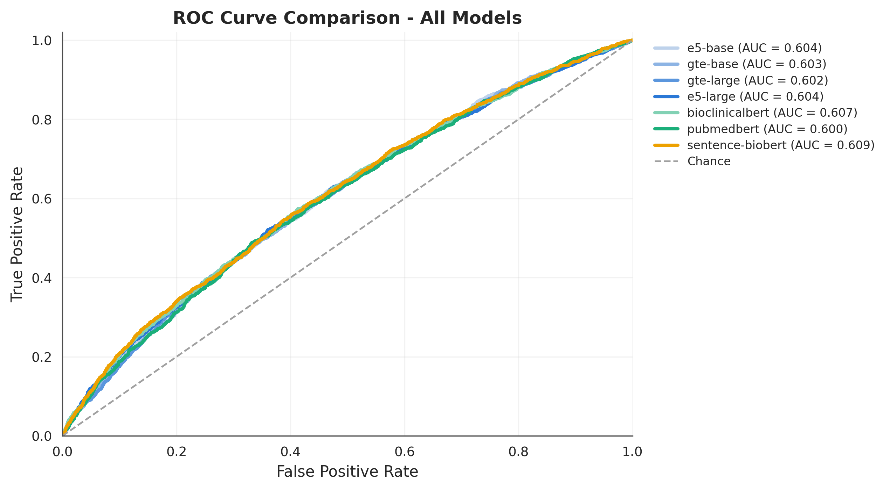

---

## 🧩 Confusion Matrix

### e5-base

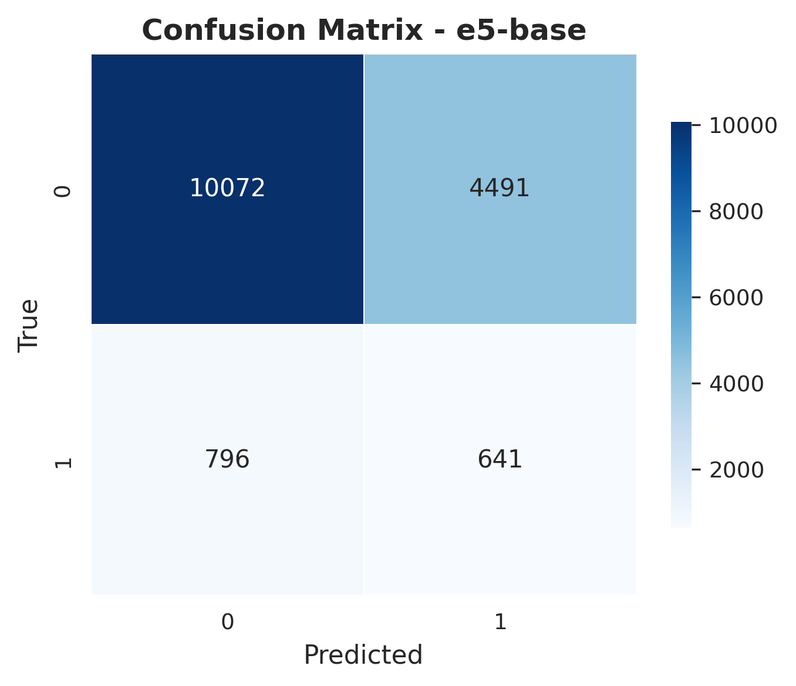

### gte-base

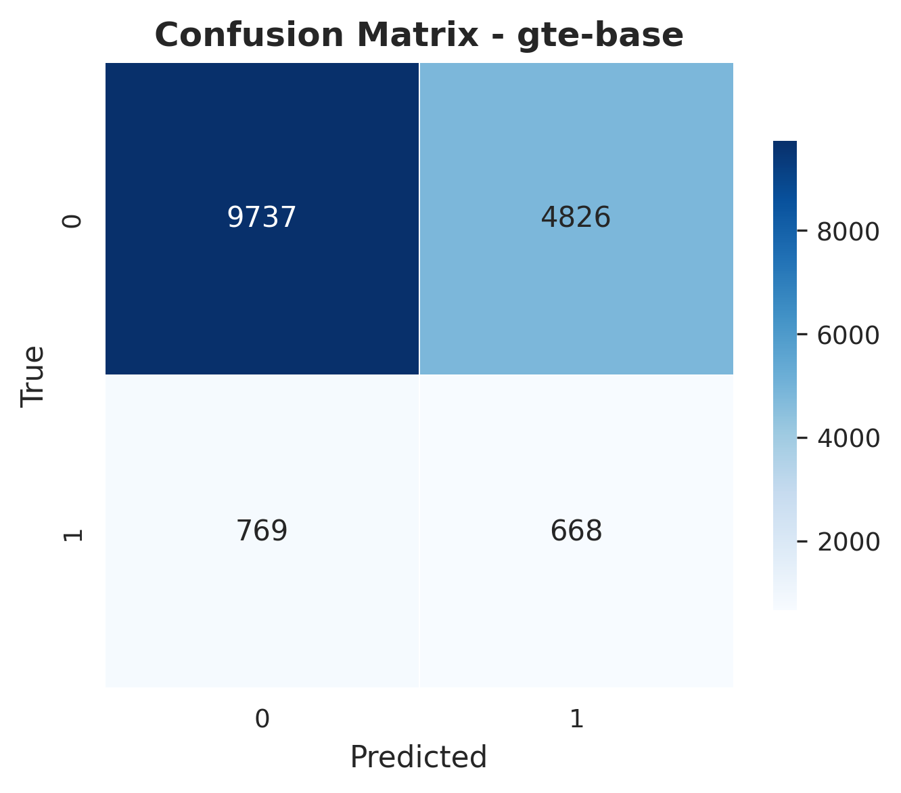

### gte-large

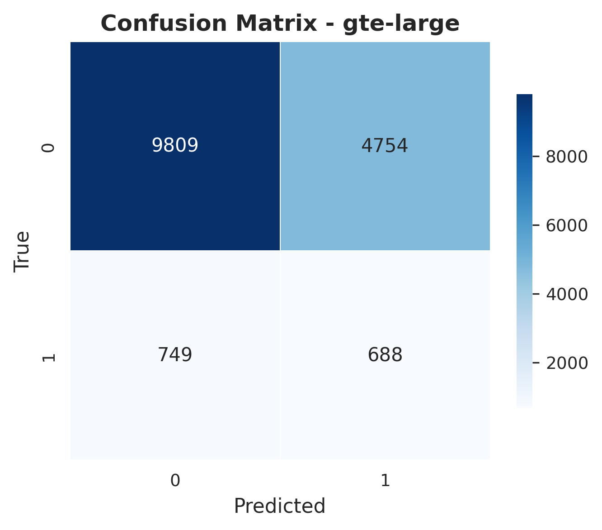

### e5-large

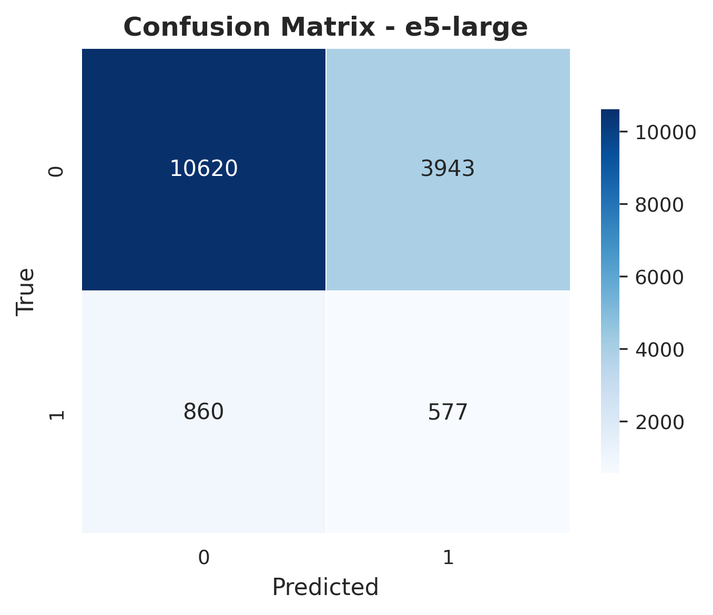

### bioclinicalbert

### pubmedbert

### sentence-biobert

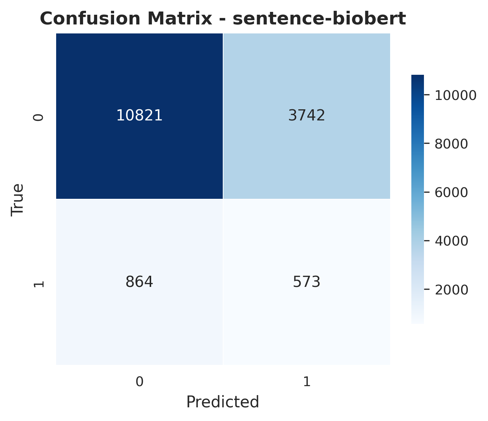

---

## 📦 Bootstrapped Metric Boxplot

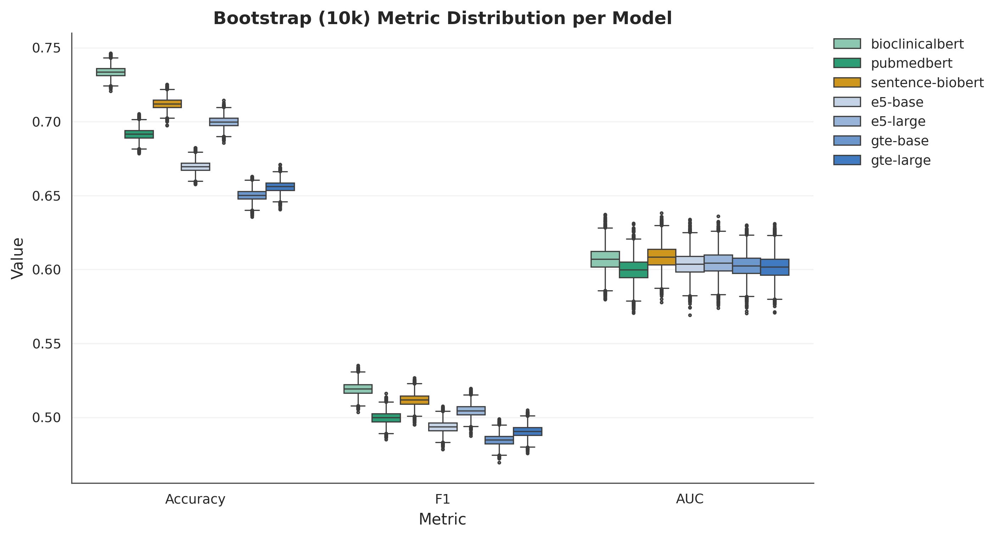

---

## 📐 Mean ± Confidence Interval

Mean metric per model with 95% bootstrap confidence interval (thin whisker) and ±1 standard deviation (thick whisker).

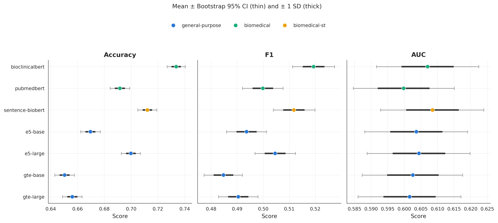

---

## 🧬 Model Family Comparison

Bootstrap metric distributions pooled by model family: general-purpose vs. biomedical vs. biomedical sentence-transformers.

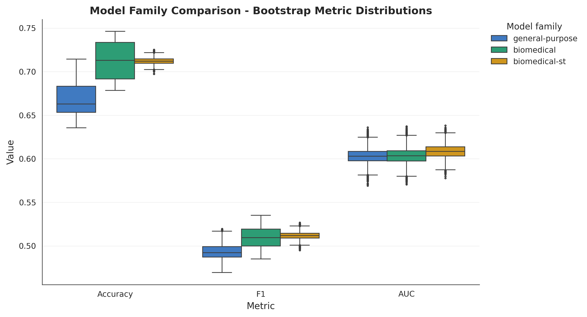

---

## 🩺 Error Analysis

Misclassified cases (false positives / false negatives) are traced back to the original clinical record for every model, using the fold validation indices saved during training.

### Error rates per model

| model            |   n_errors |   n_fp |   n_fn |   fp_rate |   fn_rate |
|:-----------------|-----------:|-------:|-------:|----------:|----------:|
| e5-base          |       5287 |   4491 |    796 |  0.308384 |  0.553932 |
| gte-base         |       5595 |   4826 |    769 |  0.331388 |  0.535143 |
| gte-large        |       5503 |   4754 |    749 |  0.326444 |  0.521225 |
| e5-large         |       4803 |   3943 |    860 |  0.270755 |  0.598469 |
| bioclinicalbert  |       4262 |   3353 |    909 |  0.230241 |  0.632568 |
| pubmedbert       |       4934 |   4077 |    857 |  0.279956 |  0.596381 |
| sentence-biobert |       4606 |   3742 |    864 |  0.256953 |  0.601253 |

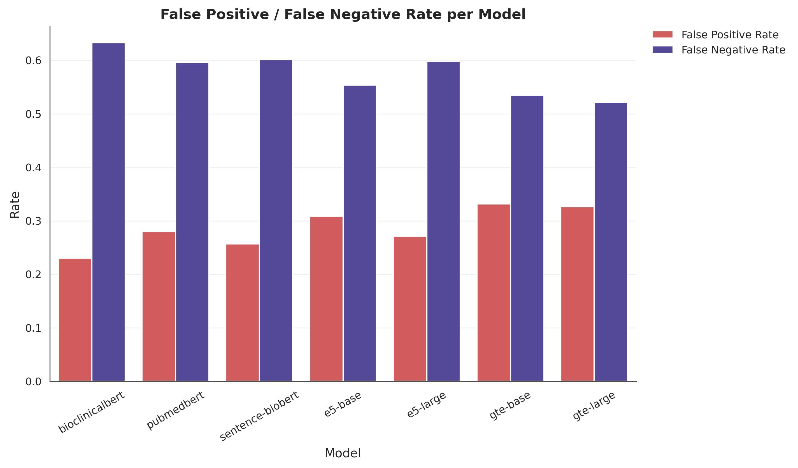

### Clinical feature deviation: misclassified vs. correctly classified

Standardized mean difference per clinical feature, pooled across all models (positive = higher in misclassified cases).

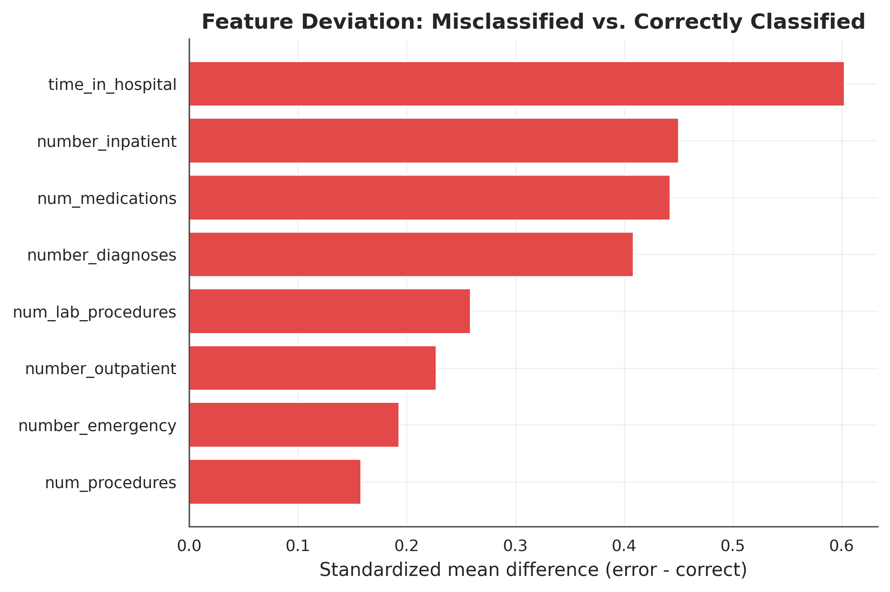

### Hardest cases (most frequently misclassified across models)

| race      | gender   | age     |   admission_type_id |   discharge_disposition_id |   admission_source_id |   time_in_hospital |   num_lab_procedures |   num_procedures |   num_medications |   number_outpatient |   number_emergency |   number_inpatient |   number_diagnoses |   max_glu_serum |   A1Cresult | insulin   | change   | diabetesMed   |   n_models_wrong |   n_models_evaluated |
|:----------|:---------|:--------|--------------------:|---------------------------:|----------------------:|-------------------:|---------------------:|-----------------:|------------------:|--------------------:|-------------------:|-------------------:|-------------------:|----------------:|------------:|:----------|:---------|:--------------|-----------------:|---------------------:|
| Caucasian | Female   | [70-80) |                   1 |                          3 |                     7 |                  5 |                   52 |                3 |                 6 |                  14 |                  0 |                  1 |                  9 |             nan |         nan | No        | No       | No            |                7 |                    7 |
| Caucasian | Female   | [80-90) |                   1 |                          1 |                     7 |                  5 |                   48 |                0 |                18 |                   0 |                  0 |                  1 |                  8 |             nan |         nan | No        | No       | Yes           |                7 |                    7 |
| Caucasian | Male     | [50-60) |                   3 |                          1 |                     1 |                  5 |                   51 |                1 |                17 |                   0 |                  0 |                  0 |                  9 |             nan |         nan | No        | No       | Yes           |                7 |                    7 |
| Caucasian | Female   | [80-90) |                   3 |                          6 |                     5 |                  7 |                   49 |                2 |                12 |                   0 |                  0 |                  1 |                  7 |             nan |         nan | Steady    | Ch       | Yes           |                7 |                    7 |
| Caucasian | Female   | [60-70) |                   1 |                          6 |                     7 |                  7 |                   47 |                0 |                23 |                   1 |                  0 |                  1 |                  9 |             nan |         nan | Down      | Ch       | Yes           |                7 |                    7 |
| Caucasian | Female   | [60-70) |                   1 |                          3 |                     5 |                  7 |                   74 |                0 |                32 |                   0 |                  0 |                  1 |                  9 |             nan |         nan | Steady    | No       | Yes           |                7 |                    7 |
| Caucasian | Male     | [70-80) |                   1 |                          6 |                     5 |                  8 |                   43 |                0 |                14 |                   0 |                  0 |                  1 |                  9 |             nan |         nan | No        | No       | Yes           |                7 |                    7 |
| Caucasian | Male     | [70-80) |                   1 |                          1 |                     7 |                  3 |                   62 |                0 |                11 |                   0 |                  0 |                  1 |                  9 |             nan |         nan | Steady    | No       | Yes           |                7 |                    7 |
| Caucasian | Female   | [50-60) |                   1 |                          1 |                     6 |                  1 |                   54 |                0 |                 8 |                   0 |                  0 |                  0 |                  5 |             nan |         nan | Steady    | No       | Yes           |                7 |                    7 |
| Caucasian | Male     | [80-90) |                   2 |                          1 |                     7 |                  6 |                   56 |                1 |                19 |                   0 |                  0 |                  1 |                  9 |             nan |         nan | Steady    | Ch       | Yes           |                7 |                    7 |

---

## 🧪 Statistical Tests

This section reports pairwise comparisons between model bootstrap metrics using Wilcoxon signed-rank tests, paired t-tests, and DeLong AUC comparisons.

### Wilcoxon Signed-Rank Test

The Wilcoxon test compares paired bootstrap distributions for each model pair.

| metric   | model_a         | model_b          |   mean_a |   mean_b |        statistic |   p_value |   significant |   p_value_bh |   significant_bh |
|:---------|:----------------|:-----------------|---------:|---------:|-----------------:|----------:|--------------:|-------------:|-----------------:|
| acc      | e5-base         | gte-base         |   0.6696 |   0.6503 |      0           |         0 |             1 |            0 |                1 |
| acc      | e5-base         | gte-large        |   0.6696 |   0.6561 |      0           |         0 |             1 |            0 |                1 |
| acc      | e5-base         | e5-large         |   0.6696 |   0.6998 |      0           |         0 |             1 |            0 |                1 |
| acc      | e5-base         | bioclinicalbert  |   0.6696 |   0.7337 |      0           |         0 |             1 |            0 |                1 |
| acc      | e5-base         | pubmedbert       |   0.6696 |   0.6916 |      0           |         0 |             1 |            0 |                1 |
| acc      | e5-base         | sentence-biobert |   0.6696 |   0.7121 |      0           |         0 |             1 |            0 |                1 |
| acc      | gte-base        | gte-large        |   0.6503 |   0.6561 | 254741           |         0 |             1 |            0 |                1 |
| acc      | gte-base        | e5-large         |   0.6503 |   0.6998 |      0           |         0 |             1 |            0 |                1 |
| acc      | gte-base        | bioclinicalbert  |   0.6503 |   0.7337 |      0           |         0 |             1 |            0 |                1 |
| acc      | gte-base        | pubmedbert       |   0.6503 |   0.6916 |      0           |         0 |             1 |            0 |                1 |
| acc      | gte-base        | sentence-biobert |   0.6503 |   0.7121 |      0           |         0 |             1 |            0 |                1 |
| acc      | gte-large       | e5-large         |   0.6561 |   0.6998 |      0           |         0 |             1 |            0 |                1 |
| acc      | gte-large       | bioclinicalbert  |   0.6561 |   0.7337 |      0           |         0 |             1 |            0 |                1 |
| acc      | gte-large       | pubmedbert       |   0.6561 |   0.6916 |      0           |         0 |             1 |            0 |                1 |
| acc      | gte-large       | sentence-biobert |   0.6561 |   0.7121 |      0           |         0 |             1 |            0 |                1 |
| acc      | e5-large        | bioclinicalbert  |   0.6998 |   0.7337 |      0           |         0 |             1 |            0 |                1 |
| acc      | e5-large        | pubmedbert       |   0.6998 |   0.6916 |   2645.5         |         0 |             1 |            0 |                1 |
| acc      | e5-large        | sentence-biobert |   0.6998 |   0.7121 |      0           |         0 |             1 |            0 |                1 |
| acc      | bioclinicalbert | pubmedbert       |   0.7337 |   0.6916 |      0           |         0 |             1 |            0 |                1 |
| acc      | bioclinicalbert | sentence-biobert |   0.7337 |   0.7121 |      0           |         0 |             1 |            0 |                1 |
| acc      | pubmedbert      | sentence-biobert |   0.6916 |   0.7121 |      0           |         0 |             1 |            0 |                1 |
| f1       | e5-base         | gte-base         |   0.4936 |   0.4848 |    409           |         0 |             1 |            0 |                1 |
| f1       | e5-base         | gte-large        |   0.4936 |   0.4905 |      4.19246e+06 |         0 |             1 |            0 |                1 |
| f1       | e5-base         | e5-large         |   0.4936 |   0.5046 |     48           |         0 |             1 |            0 |                1 |
| f1       | e5-base         | bioclinicalbert  |   0.4936 |   0.5194 |      0           |         0 |             1 |            0 |                1 |
| f1       | e5-base         | pubmedbert       |   0.4936 |   0.4999 | 136119           |         0 |             1 |            0 |                1 |
| f1       | e5-base         | sentence-biobert |   0.4936 |   0.5118 |      0           |         0 |             1 |            0 |                1 |
| f1       | gte-base        | gte-large        |   0.4848 |   0.4905 | 146937           |         0 |             1 |            0 |                1 |
| f1       | gte-base        | e5-large         |   0.4848 |   0.5046 |      0           |         0 |             1 |            0 |                1 |
| f1       | gte-base        | bioclinicalbert  |   0.4848 |   0.5194 |      0           |         0 |             1 |            0 |                1 |
| f1       | gte-base        | pubmedbert       |   0.4848 |   0.4999 |      0           |         0 |             1 |            0 |                1 |
| f1       | gte-base        | sentence-biobert |   0.4848 |   0.5118 |      0           |         0 |             1 |            0 |                1 |
| f1       | gte-large       | e5-large         |   0.4905 |   0.5046 |      0           |         0 |             1 |            0 |                1 |
| f1       | gte-large       | bioclinicalbert  |   0.4905 |   0.5194 |      0           |         0 |             1 |            0 |                1 |
| f1       | gte-large       | pubmedbert       |   0.4905 |   0.4999 |    208           |         0 |             1 |            0 |                1 |
| f1       | gte-large       | sentence-biobert |   0.4905 |   0.5118 |      0           |         0 |             1 |            0 |                1 |
| f1       | e5-large        | bioclinicalbert  |   0.5046 |   0.5194 |      0           |         0 |             1 |            0 |                1 |
| f1       | e5-large        | pubmedbert       |   0.5046 |   0.4999 | 726046           |         0 |             1 |            0 |                1 |
| f1       | e5-large        | sentence-biobert |   0.5046 |   0.5118 |  19203           |         0 |             1 |            0 |                1 |
| f1       | bioclinicalbert | pubmedbert       |   0.5194 |   0.4999 |      0           |         0 |             1 |            0 |                1 |
| f1       | bioclinicalbert | sentence-biobert |   0.5194 |   0.5118 |  17291           |         0 |             1 |            0 |                1 |
| f1       | pubmedbert      | sentence-biobert |   0.4999 |   0.5118 |      0           |         0 |             1 |            0 |                1 |
| auc      | e5-base         | gte-base         |   0.6036 |   0.6026 |      1.78488e+07 |         0 |             1 |            0 |                1 |
| auc      | e5-base         | gte-large        |   0.6036 |   0.6016 |      1.46349e+07 |         0 |             1 |            0 |                1 |
| auc      | e5-base         | e5-large         |   0.6036 |   0.6044 |      1.9801e+07  |         0 |             1 |            0 |                1 |
| auc      | e5-base         | bioclinicalbert  |   0.6036 |   0.607  |      5.27763e+06 |         0 |             1 |            0 |                1 |
| auc      | e5-base         | pubmedbert       |   0.6036 |   0.5998 |      4.37642e+06 |         0 |             1 |            0 |                1 |
| auc      | e5-base         | sentence-biobert |   0.6036 |   0.6085 |      3.14715e+06 |         0 |             1 |            0 |                1 |
| auc      | gte-base        | gte-large        |   0.6026 |   0.6016 |      1.96048e+07 |         0 |             1 |            0 |                1 |
| auc      | gte-base        | e5-large         |   0.6026 |   0.6044 |      1.41902e+07 |         0 |             1 |            0 |                1 |
| auc      | gte-base        | bioclinicalbert  |   0.6026 |   0.607  |      3.90931e+06 |         0 |             1 |            0 |                1 |
| auc      | gte-base        | pubmedbert       |   0.6026 |   0.5998 |      7.95358e+06 |         0 |             1 |            0 |                1 |
| auc      | gte-base        | sentence-biobert |   0.6026 |   0.6085 |      1.78089e+06 |         0 |             1 |            0 |                1 |
| auc      | gte-large       | e5-large         |   0.6016 |   0.6044 |      1.14477e+07 |         0 |             1 |            0 |                1 |
| auc      | gte-large       | bioclinicalbert  |   0.6016 |   0.607  |      3.86901e+06 |         0 |             1 |            0 |                1 |
| auc      | gte-large       | pubmedbert       |   0.6016 |   0.5998 |      1.57374e+07 |         0 |             1 |            0 |                1 |
| auc      | gte-large       | sentence-biobert |   0.6016 |   0.6085 |      1.96132e+06 |         0 |             1 |            0 |                1 |
| auc      | e5-large        | bioclinicalbert  |   0.6044 |   0.607  |      9.66068e+06 |         0 |             1 |            0 |                1 |
| auc      | e5-large        | pubmedbert       |   0.6044 |   0.5998 |      3.60887e+06 |         0 |             1 |            0 |                1 |
| auc      | e5-large        | sentence-biobert |   0.6044 |   0.6085 |      4.5506e+06  |         0 |             1 |            0 |                1 |
| auc      | bioclinicalbert | pubmedbert       |   0.607  |   0.5998 | 134903           |         0 |             1 |            0 |                1 |
| auc      | bioclinicalbert | sentence-biobert |   0.607  |   0.6085 |      1.42081e+07 |         0 |             1 |            0 |                1 |
| auc      | pubmedbert      | sentence-biobert |   0.5998 |   0.6085 | 112653           |         0 |             1 |            0 |                1 |

### Paired t-test

The paired t-test compares paired bootstrap means for each model pair.

| metric   | model_a         | model_b          |   mean_a |   mean_b |   statistic |   p_value |   significant |   p_value_bh |   significant_bh |
|:---------|:----------------|:-----------------|---------:|---------:|------------:|----------:|--------------:|-------------:|-----------------:|
| acc      | e5-base         | gte-base         |   0.6696 |   0.6503 |    603.889  |         0 |             1 |            0 |                1 |
| acc      | e5-base         | gte-large        |   0.6696 |   0.6561 |    395.911  |         0 |             1 |            0 |                1 |
| acc      | e5-base         | e5-large         |   0.6696 |   0.6998 |   -898.252  |         0 |             1 |            0 |                1 |
| acc      | e5-base         | bioclinicalbert  |   0.6696 |   0.7337 |  -1971.41   |         0 |             1 |            0 |                1 |
| acc      | e5-base         | pubmedbert       |   0.6696 |   0.6916 |   -689.623  |         0 |             1 |            0 |                1 |
| acc      | e5-base         | sentence-biobert |   0.6696 |   0.7121 |  -1308.7    |         0 |             1 |            0 |                1 |
| acc      | gte-base        | gte-large        |   0.6503 |   0.6561 |   -181.132  |         0 |             1 |            0 |                1 |
| acc      | gte-base        | e5-large         |   0.6503 |   0.6998 |  -1572.32   |         0 |             1 |            0 |                1 |
| acc      | gte-base        | bioclinicalbert  |   0.6503 |   0.7337 |  -2665.94   |         0 |             1 |            0 |                1 |
| acc      | gte-base        | pubmedbert       |   0.6503 |   0.6916 |  -1381.05   |         0 |             1 |            0 |                1 |
| acc      | gte-base        | sentence-biobert |   0.6503 |   0.7121 |  -1935.35   |         0 |             1 |            0 |                1 |
| acc      | gte-large       | e5-large         |   0.6561 |   0.6998 |  -1287.98   |         0 |             1 |            0 |                1 |
| acc      | gte-large       | bioclinicalbert  |   0.6561 |   0.7337 |  -2271.79   |         0 |             1 |            0 |                1 |
| acc      | gte-large       | pubmedbert       |   0.6561 |   0.6916 |  -1072.72   |         0 |             1 |            0 |                1 |
| acc      | gte-large       | sentence-biobert |   0.6561 |   0.7121 |  -1637.97   |         0 |             1 |            0 |                1 |
| acc      | e5-large        | bioclinicalbert  |   0.6998 |   0.7337 |  -1165.45   |         0 |             1 |            0 |                1 |
| acc      | e5-large        | pubmedbert       |   0.6998 |   0.6916 |    272.328  |         0 |             1 |            0 |                1 |
| acc      | e5-large        | sentence-biobert |   0.6998 |   0.7121 |   -420.604  |         0 |             1 |            0 |                1 |
| acc      | bioclinicalbert | pubmedbert       |   0.7337 |   0.6916 |   1476.17   |         0 |             1 |            0 |                1 |
| acc      | bioclinicalbert | sentence-biobert |   0.7337 |   0.7121 |    764.678  |         0 |             1 |            0 |                1 |
| acc      | pubmedbert      | sentence-biobert |   0.6916 |   0.7121 |   -703.638  |         0 |             1 |            0 |                1 |
| f1       | e5-base         | gte-base         |   0.4936 |   0.4848 |    292.904  |         0 |             1 |            0 |                1 |
| f1       | e5-base         | gte-large        |   0.4936 |   0.4905 |     97.6188 |         0 |             1 |            0 |                1 |
| f1       | e5-base         | e5-large         |   0.4936 |   0.5046 |   -326.659  |         0 |             1 |            0 |                1 |
| f1       | e5-base         | bioclinicalbert  |   0.4936 |   0.5194 |   -750.022  |         0 |             1 |            0 |                1 |
| f1       | e5-base         | pubmedbert       |   0.4936 |   0.4999 |   -196.391  |         0 |             1 |            0 |                1 |
| f1       | e5-base         | sentence-biobert |   0.4936 |   0.5118 |   -545.697  |         0 |             1 |            0 |                1 |
| f1       | gte-base        | gte-large        |   0.4848 |   0.4905 |   -193.417  |         0 |             1 |            0 |                1 |
| f1       | gte-base        | e5-large         |   0.4848 |   0.5046 |   -657.563  |         0 |             1 |            0 |                1 |
| f1       | gte-base        | bioclinicalbert  |   0.4848 |   0.5194 |  -1054.79   |         0 |             1 |            0 |                1 |
| f1       | gte-base        | pubmedbert       |   0.4848 |   0.4999 |   -514.045  |         0 |             1 |            0 |                1 |
| f1       | gte-base        | sentence-biobert |   0.4848 |   0.5118 |   -856.504  |         0 |             1 |            0 |                1 |
| f1       | gte-large       | e5-large         |   0.4905 |   0.5046 |   -426.526  |         0 |             1 |            0 |                1 |
| f1       | gte-large       | bioclinicalbert  |   0.4905 |   0.5194 |   -820.316  |         0 |             1 |            0 |                1 |
| f1       | gte-large       | pubmedbert       |   0.4905 |   0.4999 |   -296.054  |         0 |             1 |            0 |                1 |
| f1       | gte-large       | sentence-biobert |   0.4905 |   0.5118 |   -632.952  |         0 |             1 |            0 |                1 |
| f1       | e5-large        | bioclinicalbert  |   0.5046 |   0.5194 |   -471.07   |         0 |             1 |            0 |                1 |
| f1       | e5-large        | pubmedbert       |   0.5046 |   0.4999 |    154.646  |         0 |             1 |            0 |                1 |
| f1       | e5-large        | sentence-biobert |   0.5046 |   0.5118 |   -235.018  |         0 |             1 |            0 |                1 |
| f1       | bioclinicalbert | pubmedbert       |   0.5194 |   0.4999 |    629.917  |         0 |             1 |            0 |                1 |
| f1       | bioclinicalbert | sentence-biobert |   0.5194 |   0.5118 |    243.242  |         0 |             1 |            0 |                1 |
| f1       | pubmedbert      | sentence-biobert |   0.4999 |   0.5118 |   -397.004  |         0 |             1 |            0 |                1 |
| auc      | e5-base         | gte-base         |   0.6036 |   0.6026 |     26.0922 |         0 |             1 |            0 |                1 |
| auc      | e5-base         | gte-large        |   0.6036 |   0.6016 |     38.9168 |         0 |             1 |            0 |                1 |
| auc      | e5-base         | e5-large         |   0.6036 |   0.6044 |    -18.2915 |         0 |             1 |            0 |                1 |
| auc      | e5-base         | bioclinicalbert  |   0.6036 |   0.607  |    -88.236  |         0 |             1 |            0 |                1 |
| auc      | e5-base         | pubmedbert       |   0.6036 |   0.5998 |     96.0699 |         0 |             1 |            0 |                1 |
| auc      | e5-base         | sentence-biobert |   0.6036 |   0.6085 |   -108.003  |         0 |             1 |            0 |                1 |
| auc      | gte-base        | gte-large        |   0.6026 |   0.6016 |     19.577  |         0 |             1 |            0 |                1 |
| auc      | gte-base        | e5-large         |   0.6026 |   0.6044 |    -40.4449 |         0 |             1 |            0 |                1 |
| auc      | gte-base        | bioclinicalbert  |   0.6026 |   0.607  |   -100.12   |         0 |             1 |            0 |                1 |
| auc      | gte-base        | pubmedbert       |   0.6026 |   0.5998 |     70.5986 |         0 |             1 |            0 |                1 |
| auc      | gte-base        | sentence-biobert |   0.6026 |   0.6085 |   -127.491  |         0 |             1 |            0 |                1 |
| auc      | gte-large       | e5-large         |   0.6016 |   0.6044 |    -52.678  |         0 |             1 |            0 |                1 |
| auc      | gte-large       | bioclinicalbert  |   0.6016 |   0.607  |   -100.47   |         0 |             1 |            0 |                1 |
| auc      | gte-large       | pubmedbert       |   0.6016 |   0.5998 |     34.0569 |         0 |             1 |            0 |                1 |
| auc      | gte-large       | sentence-biobert |   0.6016 |   0.6085 |   -124.8    |         0 |             1 |            0 |                1 |
| auc      | e5-large        | bioclinicalbert  |   0.6044 |   0.607  |    -61.2571 |         0 |             1 |            0 |                1 |
| auc      | e5-large        | pubmedbert       |   0.6044 |   0.5998 |    103.264  |         0 |             1 |            0 |                1 |
| auc      | e5-large        | sentence-biobert |   0.6044 |   0.6085 |    -94.5361 |         0 |             1 |            0 |                1 |
| auc      | bioclinicalbert | pubmedbert       |   0.607  |   0.5998 |    196.135  |         0 |             1 |            0 |                1 |
| auc      | bioclinicalbert | sentence-biobert |   0.607  |   0.6085 |    -40.0953 |         0 |             1 |            0 |                1 |
| auc      | pubmedbert      | sentence-biobert |   0.5998 |   0.6085 |   -197.392  |         0 |             1 |            0 |                1 |

### DeLong AUC Comparison

The DeLong test compares AUC performance between model pairs on the same test labels.

| model_a         | model_b          |   auc_a |   auc_b |   delta_auc |   z_statistic |   p_value |   significant |   p_value_bh |   significant_bh |
|:----------------|:-----------------|--------:|--------:|------------:|--------------:|----------:|--------------:|-------------:|-----------------:|
| e5-base         | gte-base         |  0.6037 |  0.6027 |      0.001  |       -0.2516 |    0.8013 |             0 |       0.8594 |                0 |
| e5-base         | gte-large        |  0.6037 |  0.6016 |      0.0021 |       -0.4067 |    0.6842 |             0 |       0.8594 |                0 |
| e5-base         | e5-large         |  0.6037 |  0.6045 |     -0.0008 |        0.1771 |    0.8594 |             0 |       0.8594 |                0 |
| e5-base         | bioclinicalbert  |  0.6037 |  0.6071 |     -0.0034 |        0.8876 |    0.3748 |             0 |       0.7155 |                0 |
| e5-base         | pubmedbert       |  0.6037 |  0.5999 |      0.0038 |       -0.9622 |    0.3359 |             0 |       0.7155 |                0 |
| e5-base         | sentence-biobert |  0.6037 |  0.6086 |     -0.0049 |        1.0927 |    0.2745 |             0 |       0.7155 |                0 |
| gte-base        | gte-large        |  0.6027 |  0.6016 |      0.0011 |       -0.2238 |    0.8229 |             0 |       0.8594 |                0 |
| gte-base        | e5-large         |  0.6027 |  0.6045 |     -0.0018 |        0.3856 |    0.6998 |             0 |       0.8594 |                0 |
| gte-base        | bioclinicalbert  |  0.6027 |  0.6071 |     -0.0044 |        0.9929 |    0.3207 |             0 |       0.7155 |                0 |
| gte-base        | pubmedbert       |  0.6027 |  0.5999 |      0.0028 |       -0.7064 |    0.4799 |             0 |       0.8398 |                0 |
| gte-base        | sentence-biobert |  0.6027 |  0.6086 |     -0.0059 |        1.2711 |    0.2037 |             0 |       0.7155 |                0 |
| gte-large       | e5-large         |  0.6016 |  0.6045 |     -0.0029 |        0.538  |    0.5906 |             0 |       0.8594 |                0 |
| gte-large       | bioclinicalbert  |  0.6016 |  0.6071 |     -0.0055 |        1.0371 |    0.2997 |             0 |       0.7155 |                0 |
| gte-large       | pubmedbert       |  0.6016 |  0.5999 |      0.0017 |       -0.3225 |    0.7471 |             0 |       0.8594 |                0 |
| gte-large       | sentence-biobert |  0.6016 |  0.6086 |     -0.007  |        1.2829 |    0.1995 |             0 |       0.7155 |                0 |
| e5-large        | bioclinicalbert  |  0.6045 |  0.6071 |     -0.0026 |        0.6175 |    0.5369 |             0 |       0.8594 |                0 |
| e5-large        | pubmedbert       |  0.6045 |  0.5999 |      0.0046 |       -1.0154 |    0.3099 |             0 |       0.7155 |                0 |
| e5-large        | sentence-biobert |  0.6045 |  0.6086 |     -0.0041 |        0.9507 |    0.3418 |             0 |       0.7155 |                0 |
| bioclinicalbert | pubmedbert       |  0.6071 |  0.5999 |      0.0072 |       -1.9718 |    0.0486 |             1 |       0.5198 |                0 |
| bioclinicalbert | sentence-biobert |  0.6071 |  0.6086 |     -0.0015 |        0.396  |    0.6921 |             0 |       0.8594 |                0 |
| pubmedbert      | sentence-biobert |  0.5999 |  0.6086 |     -0.0087 |        1.9645 |    0.0495 |             1 |       0.5198 |                0 |

---

## 🧾 Held-Out Test Set Evaluation

Metrics on the 20% test split created in `preprocessing.py` and never used for training, threshold calibration, or the model comparisons above — the counterpart to the 5-fold cross-validation results, on data none of those steps ever saw.

| model            |   n_test |   accuracy |   macro_f1 |      auc |   pr_auc |   precision |   recall |     brier |   prevalence |   threshold |     C |
|:-----------------|---------:|-----------:|-----------:|---------:|---------:|------------:|---------:|----------:|-------------:|------------:|------:|
| e5-base          |     4000 |    0.692   |   0.501679 | 0.60545  | 0.138297 |    0.126604 | 0.412256 | 0.080572  |      0.08975 |   0.103807  | 0.01  |
| gte-base         |     4000 |    0.72525 |   0.518529 | 0.622041 | 0.144081 |    0.137255 | 0.389972 | 0.080265  |      0.08975 |   0.10702   | 0.01  |
| gte-large        |     4000 |    0.72725 |   0.518711 | 0.612888 | 0.147428 |    0.136905 | 0.384401 | 0.0803206 |      0.08975 |   0.106453  | 0.01  |
| e5-large         |     4000 |    0.63175 |   0.481548 | 0.614739 | 0.144668 |    0.125672 | 0.520891 | 0.0803273 |      0.08975 |   0.0921887 | 0.01  |
| bioclinicalbert  |     4000 |    0.7015  |   0.515595 | 0.619438 | 0.150721 |    0.141015 | 0.456825 | 0.0802843 |      0.08975 |   0.102213  | 0.001 |
| pubmedbert       |     4000 |    0.647   |   0.484459 | 0.607511 | 0.138557 |    0.122581 | 0.476323 | 0.0806076 |      0.08975 |   0.0964974 | 0.01  |
| sentence-biobert |     4000 |    0.79075 |   0.537845 | 0.615841 | 0.157323 |    0.14956  | 0.284123 | 0.080149  |      0.08975 |   0.121628  | 0.01  |

---

## 📋 Tabular Baselines

Logistic regression and gradient boosting on the original columns, same split, same 5-fold CV and same threshold protocol as the encoders: the reference for judging the text representation.

| model               |   cv_auc |   cv_auc_std |   cv_pr_auc |   test_auc |   test_pr_auc |   test_brier |   test_precision |   test_recall |   threshold |
|:--------------------|---------:|-------------:|------------:|-----------:|--------------:|-------------:|-----------------:|--------------:|------------:|
| logistic_regression | 0.617669 |     0.021914 |    0.148354 |   0.643724 |      0.170142 |    0.0793469 |         0.157998 |      0.448468 |    0.101153 |
| gradient_boosting   | 0.611413 |     0.018949 |    0.14724  |   0.635747 |      0.154438 |    0.0798936 |         0.143248 |      0.437326 |    0.100638 |

## ⚖️ Embedding-Scale Sensitivity

Out-of-fold ROC-AUC under four probing protocols: raw vectors with C=1, standardized with C=1, unit-normalized with C=1, standardized with C chosen by inner CV.

| model            | family          |   raw_C1 |   standardized_C1 |   unit_norm_C1 |   standardized_Ccv | C_per_fold                                       |
|:-----------------|:----------------|---------:|------------------:|---------------:|-------------------:|:-------------------------------------------------|
| e5-base          | general-purpose | 0.488125 |          0.592264 |       0.488124 |           0.604051 | 0.01 0.01 0.0316228 0.01 0.01                    |
| gte-base         | general-purpose | 0.492143 |          0.582304 |       0.492143 |           0.605016 | 0.01 0.01 0.01 0.01 0.01                         |
| gte-large        | general-purpose | 0.555834 |          0.590296 |       0.555836 |           0.603615 | 0.0316228 0.01 0.0316228 0.01 0.0316228          |
| e5-large         | general-purpose | 0.521079 |          0.587487 |       0.521078 |           0.60382  | 0.01 0.01 0.01 0.0316228 0.0316228               |
| bioclinicalbert  | biomedical      | 0.59805  |          0.581086 |       0.55803  |           0.608616 | 0.00316228 0.01 0.00316228 0.00316228 0.00316228 |
| pubmedbert       | biomedical      | 0.596574 |          0.583138 |       0.505901 |           0.602598 | 0.01 0.01 0.01 0.00316228 0.01                   |
| sentence-biobert | biomedical-st   | 0.606375 |          0.582823 |       0.598663 |           0.610388 | 0.01 0.00316228 0.00316228 0.00316228 0.01       |

### DeLong under the standardized, CV-tuned protocol

| model_a         | model_b          |    auc_a |    auc_b |    delta_auc |   p_value |   p_value_bh |   significant_bh |
|:----------------|:-----------------|---------:|---------:|-------------:|----------:|-------------:|-----------------:|
| e5-base         | gte-base         | 0.604051 | 0.605016 | -0.000964876 | 0.805032  |     0.969989 |                0 |
| e5-base         | gte-large        | 0.604051 | 0.603615 |  0.000436278 | 0.932561  |     0.969989 |                0 |
| e5-base         | e5-large         | 0.604051 | 0.60382  |  0.000231662 | 0.959419  |     0.969989 |                0 |
| e5-base         | bioclinicalbert  | 0.604051 | 0.608616 | -0.00456491  | 0.263054  |     0.756659 |                0 |
| e5-base         | pubmedbert       | 0.604051 | 0.602598 |  0.00145295  | 0.712268  |     0.969989 |                0 |
| e5-base         | sentence-biobert | 0.604051 | 0.610388 | -0.00633716  | 0.151372  |     0.756659 |                0 |
| gte-base        | gte-large        | 0.605016 | 0.603615 |  0.00140115  | 0.760135  |     0.969989 |                0 |
| gte-base        | e5-large         | 0.605016 | 0.60382  |  0.00119654  | 0.796854  |     0.969989 |                0 |
| gte-base        | bioclinicalbert  | 0.605016 | 0.608616 | -0.00360003  | 0.419444  |     0.880833 |                0 |
| gte-base        | pubmedbert       | 0.605016 | 0.602598 |  0.00241783  | 0.544922  |     0.969989 |                0 |
| gte-base        | sentence-biobert | 0.605016 | 0.610388 | -0.00537229  | 0.232571  |     0.756659 |                0 |
| gte-large       | e5-large         | 0.603615 | 0.60382  | -0.000204616 | 0.969989  |     0.969989 |                0 |
| gte-large       | bioclinicalbert  | 0.603615 | 0.608616 | -0.00500119  | 0.343617  |     0.801773 |                0 |
| gte-large       | pubmedbert       | 0.603615 | 0.602598 |  0.00101668  | 0.838503  |     0.969989 |                0 |
| gte-large       | sentence-biobert | 0.603615 | 0.610388 | -0.00677344  | 0.192847  |     0.756659 |                0 |
| e5-large        | bioclinicalbert  | 0.60382  | 0.608616 | -0.00479657  | 0.288251  |     0.756659 |                0 |
| e5-large        | pubmedbert       | 0.60382  | 0.602598 |  0.00122129  | 0.798489  |     0.969989 |                0 |
| e5-large        | sentence-biobert | 0.60382  | 0.610388 | -0.00656882  | 0.133515  |     0.756659 |                0 |
| bioclinicalbert | pubmedbert       | 0.608616 | 0.602598 |  0.00601786  | 0.130591  |     0.756659 |                0 |
| bioclinicalbert | sentence-biobert | 0.608616 | 0.610388 | -0.00177225  | 0.623682  |     0.969989 |                0 |
| pubmedbert      | sentence-biobert | 0.602598 | 0.610388 | -0.00779012  | 0.0731105 |     0.756659 |                0 |

---

## 🔍 Discussion and Observations

- **bioclinicalbert** has the highest mean accuracy in this run (0.7337).
- **bioclinicalbert** has the highest mean macro-F1 (0.5194).
- **sentence-biobert** has the highest mean ROC-AUC (0.6085), 95% bootstrap CI [0.5928, 0.6239].
- **gte-base** has the narrowest AUC confidence interval (0.0303 wide) — the most stable AUC estimate across the bootstrap resamples, independent of whether its mean AUC is also the highest.
- Averaged by family, **biomedical-st** has the highest mean AUC (0.6085) among the families present in this run. This is a descriptive average, not a statistical test: see the DeLong comparison above for which specific pairwise differences are actually significant.

---

## 🏁 Conclusions

- Validation folds and the test split keep the real class distribution (no oversampling), so accuracy must be read against the majority-class rate, not 50%. ROC-AUC is the threshold-free reference: 0.5 means no ranking ability; PR-AUC should be compared with the prevalence reported in the held-out table.
- Bootstrap resampling (10,000 iterations) gives every metric a reported confidence interval: treat a numerically higher mean as a meaningful difference only where the corresponding pairwise test below also reports significance, not from the ranking alone.
- Of the 21 pairwise AUC comparisons (DeLong test), 2 are statistically significant at alpha=0.05 — see `delong_comparison.csv` for which specific pairs, rather than assuming every numeric difference is real.

---

## 🚀 Potential Improvements

- Use the task prefixes recommended by the E5 model cards (`query: `, or the instruction format
  of multilingual-e5-large-instruct) and measure their effect.
- Write the Diabetes130 admission/discharge codes as their text labels (IDS_mapping.csv).
- Leave-one-centre-out validation on Heart Disease.
- Report calibration curves, not only discrimination metrics and the Brier score.
- Repeated cross-validation with different seeds, to include training variability in the
  confidence intervals.
- A non-linear classifier on the embeddings as an additional comparison point.
