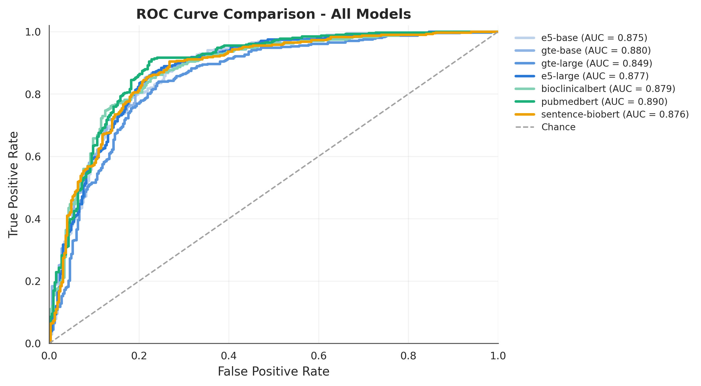
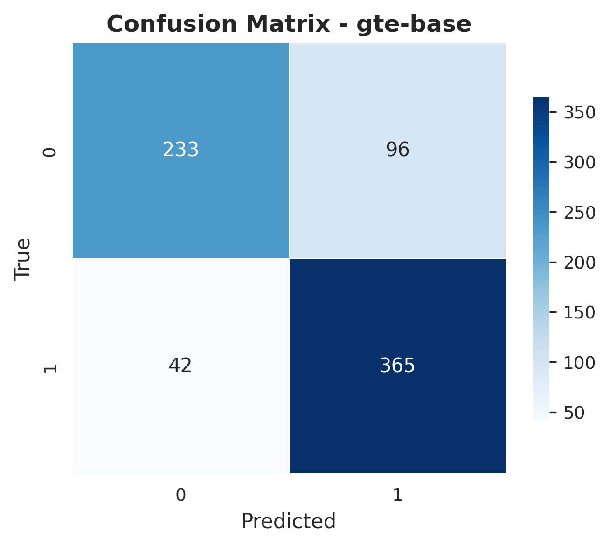
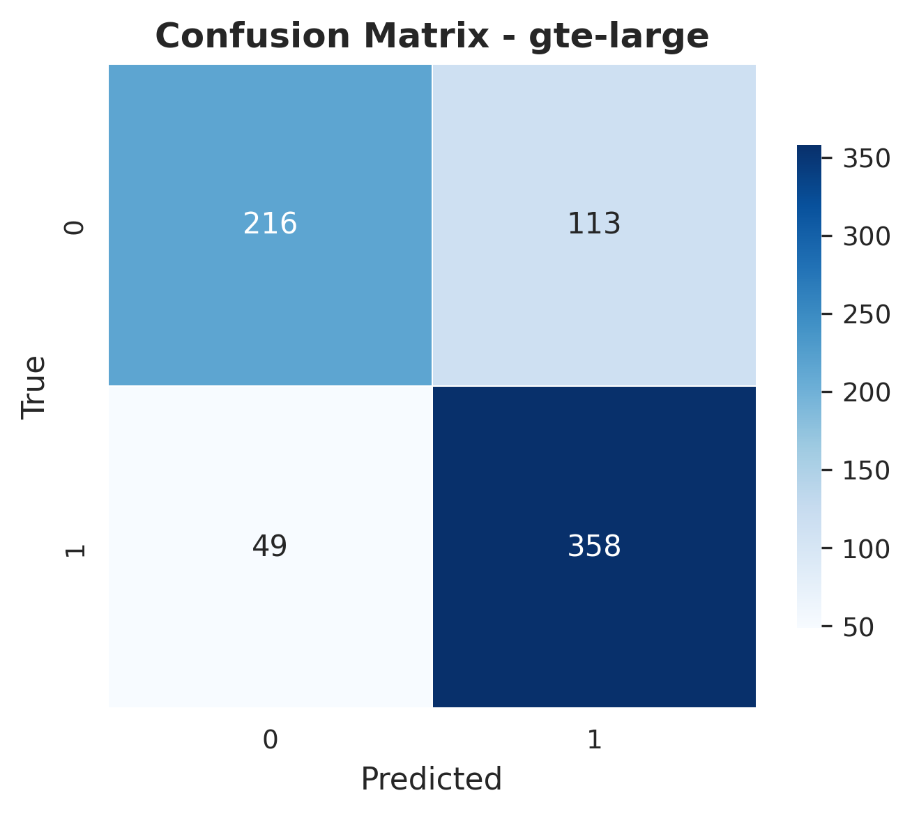
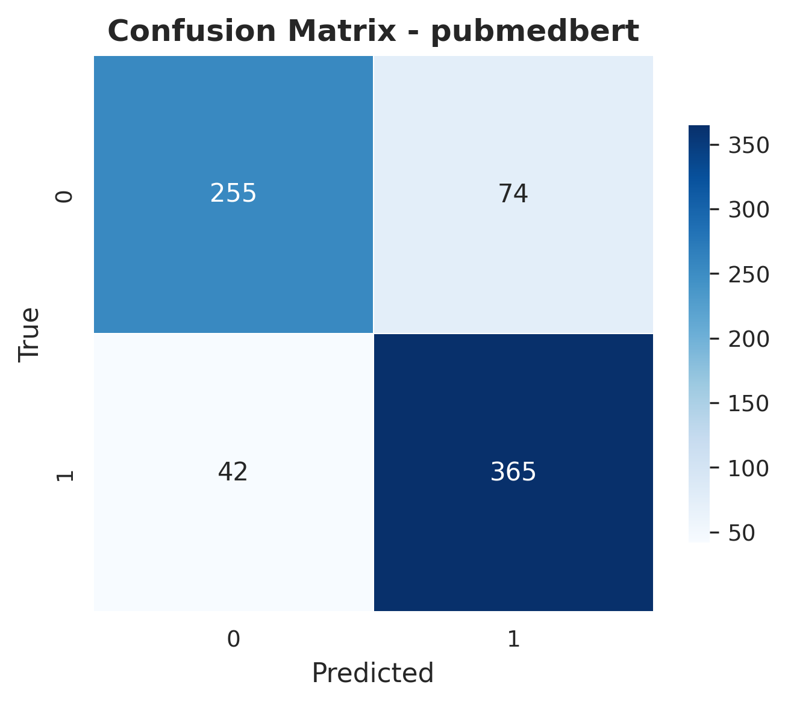
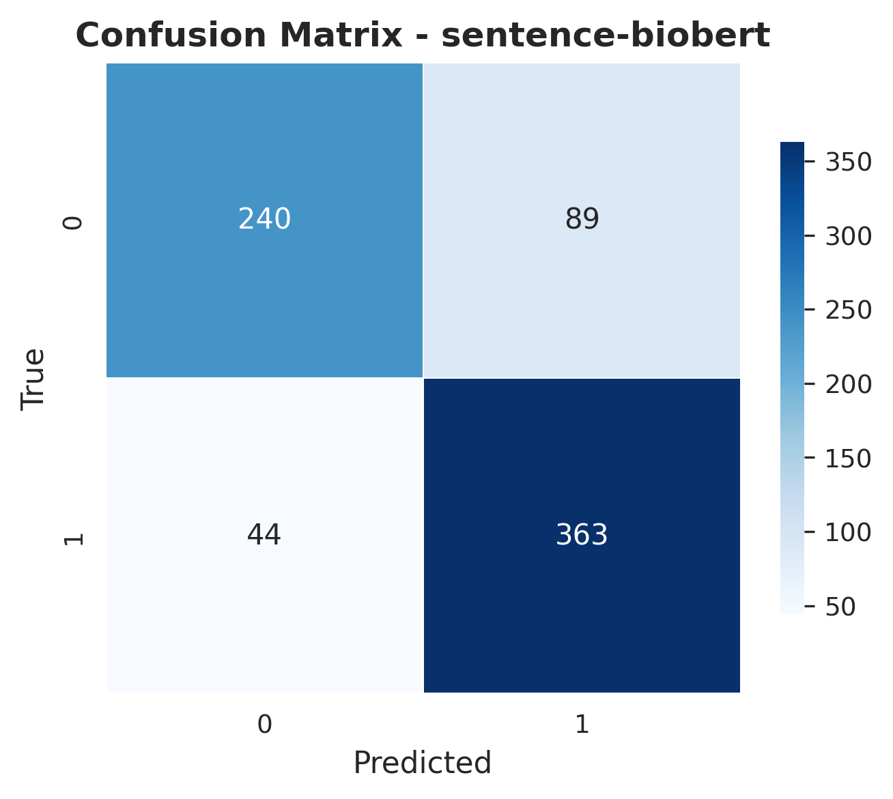
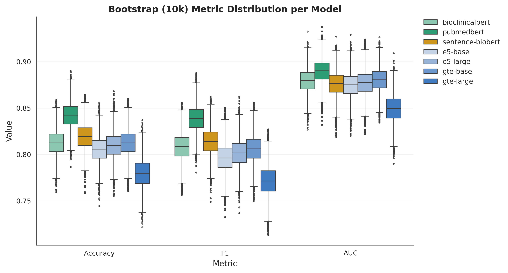
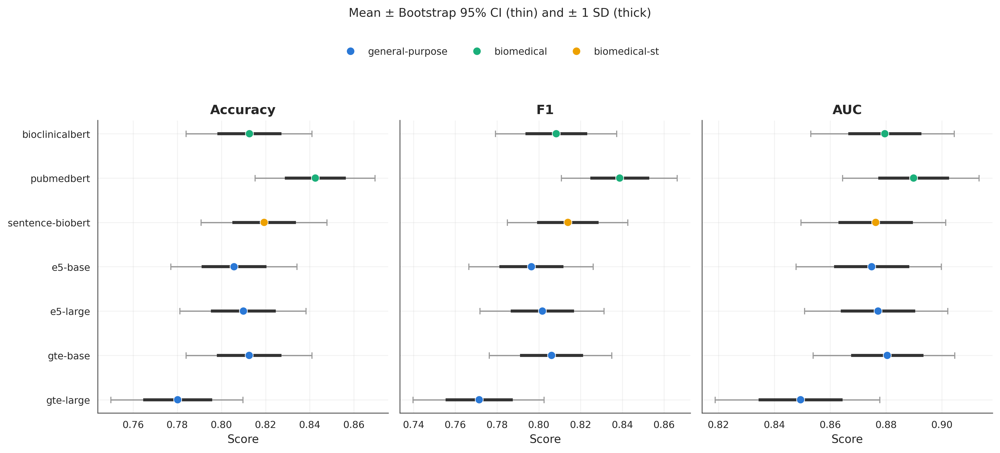
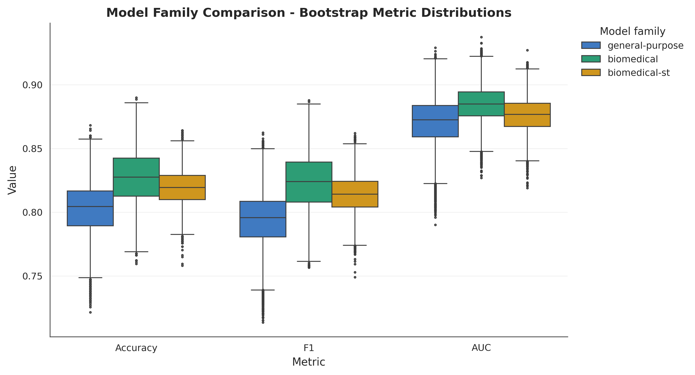
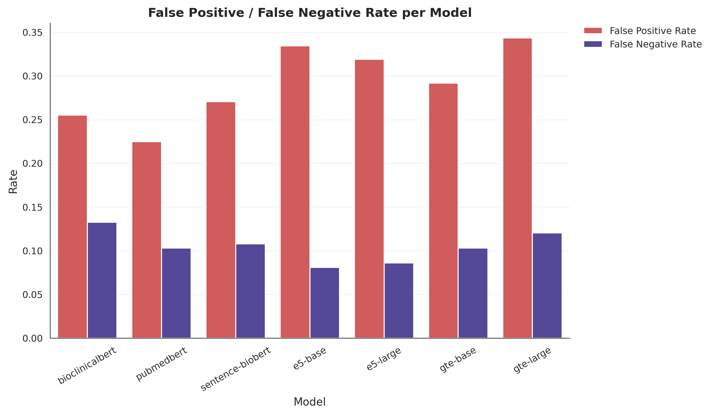
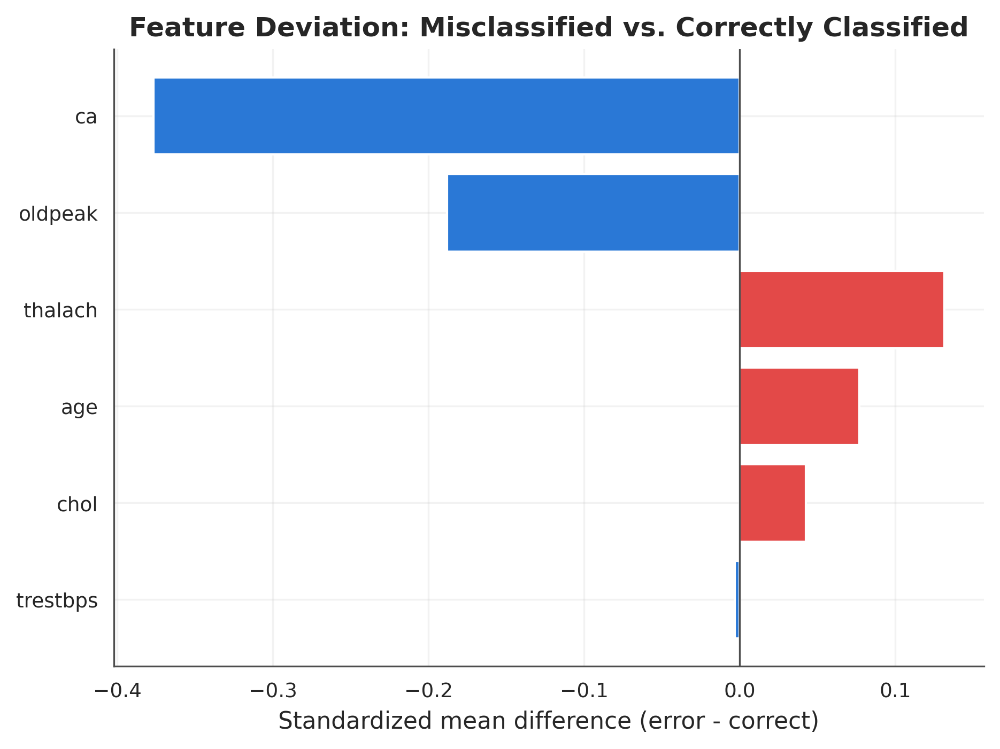

# 📊 Encoder Evaluation Report

**Generated:** 2026-11-22 21:46

---

## 🎯 Objective

Compare seven locally run text encoders (four general-purpose, three biomedical) as representations for clinical classification: each record is converted into a sentence, embedded, and classified by the same linear probe (standardized embeddings + L2 logistic regression), with 5-fold cross-validation, bootstrap confidence intervals, pairwise statistical tests and a held-out test split.

## 📘 Evaluated Models

- **e5-base**
- **gte-base**
- **gte-large**
- **e5-large**
- **bioclinicalbert**
- **pubmedbert**
- **sentence-biobert**

---

## 📈 Metric results with confidence intervals (Bootstrap 10,000)

| model            |   acc_mean |   acc_ci_low |   acc_ci_high |   acc_std |   f1_mean |   f1_ci_low |   f1_ci_high |    f1_std |   auc_mean |   auc_ci_low |   auc_ci_high |   auc_std |
|:-----------------|-----------:|-------------:|--------------:|----------:|----------:|------------:|-------------:|----------:|-----------:|-------------:|--------------:|----------:|
| e5-base          |   0.805715 |     0.77714  |      0.834239 | 0.0147378 |  0.796469 |    0.766511 |     0.825983 | 0.0153344 |   0.874866 |     0.847818 |      0.899777 | 0.0134346 |
| gte-base         |   0.812572 |     0.783967 |      0.841033 | 0.0146645 |  0.806119 |    0.776258 |     0.83499  | 0.0150917 |   0.88044  |     0.853882 |      0.904614 | 0.0129392 |
| gte-large        |   0.780189 |     0.75     |      0.809783 | 0.0155823 |  0.771456 |    0.73979  |     0.802492 | 0.016093  |   0.849414 |     0.818822 |      0.877781 | 0.0150205 |
| e5-large         |   0.809958 |     0.78125  |      0.838315 | 0.014686  |  0.801722 |    0.771871 |     0.831299 | 0.015217  |   0.877153 |     0.850802 |      0.902088 | 0.0133232 |
| bioclinicalbert  |   0.81269  |     0.783967 |      0.841033 | 0.0145101 |  0.80835  |    0.779309 |     0.837333 | 0.0148007 |   0.879577 |     0.853047 |      0.904442 | 0.0130649 |
| pubmedbert       |   0.84253  |     0.815217 |      0.869565 | 0.0138006 |  0.838742 |    0.810837 |     0.866243 | 0.0141072 |   0.889873 |     0.864456 |      0.913367 | 0.0126871 |
| sentence-biobert |   0.819348 |     0.790761 |      0.847826 | 0.0143695 |  0.813943 |    0.785005 |     0.842628 | 0.0147421 |   0.876307 |     0.849543 |      0.901349 | 0.013349  |

---

## 📉 ROC Curve Comparison

---

## 🧩 Confusion Matrix

### e5-base

### gte-base

### gte-large

### e5-large

### bioclinicalbert

### pubmedbert

### sentence-biobert

---

## 📦 Bootstrapped Metric Boxplot

---

## 📐 Mean ± Confidence Interval

Mean metric per model with 95% bootstrap confidence interval (thin whisker) and ±1 standard deviation (thick whisker).

---

## 🧬 Model Family Comparison

Bootstrap metric distributions pooled by model family: general-purpose vs. biomedical vs. biomedical sentence-transformers.

---

## 🩺 Error Analysis

Misclassified cases (false positives / false negatives) are traced back to the original clinical record for every model, using the fold validation indices saved during training.

### Error rates per model

| model            |   n_errors |   n_fp |   n_fn |   fp_rate |   fn_rate |
|:-----------------|-----------:|-------:|-------:|----------:|----------:|
| e5-base          |        143 |    110 |     33 |  0.334347 | 0.0810811 |
| gte-base         |        138 |     96 |     42 |  0.291793 | 0.103194  |
| gte-large        |        162 |    113 |     49 |  0.343465 | 0.120393  |
| e5-large         |        140 |    105 |     35 |  0.319149 | 0.0859951 |
| bioclinicalbert  |        138 |     84 |     54 |  0.255319 | 0.132678  |
| pubmedbert       |        116 |     74 |     42 |  0.224924 | 0.103194  |
| sentence-biobert |        133 |     89 |     44 |  0.270517 | 0.108108  |

### Clinical feature deviation: misclassified vs. correctly classified

Standardized mean difference per clinical feature, pooled across all models (positive = higher in misclassified cases).

### Hardest cases (most frequently misclassified across models)

|   age |   sex |   cp |   trestbps |   chol |   fbs |   restecg |   thalach |   exang |   oldpeak |   slope |   ca |   thal |   n_models_wrong |   n_models_evaluated |
|------:|------:|-----:|-----------:|-------:|------:|----------:|----------:|--------:|----------:|--------:|-----:|-------:|-----------------:|---------------------:|
|    53 |     1 |    4 |        124 |    260 |     0 |         1 |       112 |       1 |       3   |       2 |  nan |    nan |                7 |                    7 |
|    53 |     1 |    4 |         80 |    nan |   nan |         0 |       141 |       1 |       2   |       3 |  nan |    nan |                7 |                    7 |
|    57 |     0 |    4 |        180 |    347 |     0 |         1 |       126 |       1 |       0.8 |       2 |  nan |    nan |                7 |                    7 |
|    60 |     1 |    4 |        120 |    nan |     0 |         0 |       133 |       1 |       2   |       1 |  nan |      7 |                7 |                    7 |
|    46 |     1 |    3 |        150 |    231 |     0 |         0 |       147 |       0 |       3.6 |       2 |    0 |      3 |                7 |                    7 |
|    64 |     1 |    4 |        128 |    263 |     0 |         0 |       105 |       1 |       0.2 |       2 |    1 |      7 |                7 |                    7 |
|    56 |     1 |    3 |        120 |    nan |     0 |         0 |        97 |       0 |       0   |       2 |  nan |      7 |                7 |                    7 |
|    65 |     1 |    4 |        155 |    nan |   nan |         0 |       154 |       0 |       1   |       1 |  nan |    nan |                7 |                    7 |
|    66 |     1 |    4 |        120 |    302 |     0 |         2 |       151 |       0 |       0.4 |       2 |    0 |      3 |                7 |                    7 |
|    57 |     1 |    4 |        110 |    201 |     0 |         0 |       126 |       1 |       1.5 |       2 |    0 |      6 |                7 |                    7 |

---

## 🧪 Statistical Tests

This section reports pairwise comparisons between model bootstrap metrics using Wilcoxon signed-rank tests, paired t-tests, and DeLong AUC comparisons.

### Wilcoxon Signed-Rank Test

The Wilcoxon test compares paired bootstrap distributions for each model pair.

| metric   | model_a         | model_b          |   mean_a |   mean_b |        statistic |   p_value |   significant |   p_value_bh |   significant_bh |
|:---------|:----------------|:-----------------|---------:|---------:|-----------------:|----------:|--------------:|-------------:|-----------------:|
| acc      | e5-base         | gte-base         |   0.8057 |   0.8126 |      5.90981e+06 |    0      |             1 |       0      |                1 |
| acc      | e5-base         | gte-large        |   0.8057 |   0.7802 | 114115           |    0      |             1 |       0      |                1 |
| acc      | e5-base         | e5-large         |   0.8057 |   0.81   |      1.06745e+07 |    0      |             1 |       0      |                1 |
| acc      | e5-base         | bioclinicalbert  |   0.8057 |   0.8127 |      8.7959e+06  |    0      |             1 |       0      |                1 |
| acc      | e5-base         | pubmedbert       |   0.8057 |   0.8425 |     17           |    0      |             1 |       0      |                1 |
| acc      | e5-base         | sentence-biobert |   0.8057 |   0.8193 |      1.19792e+06 |    0      |             1 |       0      |                1 |
| acc      | gte-base        | gte-large        |   0.8126 |   0.7802 |   8277.5         |    0      |             1 |       0      |                1 |
| acc      | gte-base        | e5-large         |   0.8126 |   0.81   |      1.5095e+07  |    0      |             1 |       0      |                1 |
| acc      | gte-base        | bioclinicalbert  |   0.8126 |   0.8127 |      2.21886e+07 |    0.4288 |             0 |       0.4288 |                0 |
| acc      | gte-base        | pubmedbert       |   0.8126 |   0.8425 |    219           |    0      |             1 |       0      |                1 |
| acc      | gte-base        | sentence-biobert |   0.8126 |   0.8193 |      7.35335e+06 |    0      |             1 |       0      |                1 |
| acc      | gte-large       | e5-large         |   0.7802 |   0.81   |  10341           |    0      |             1 |       0      |                1 |
| acc      | gte-large       | bioclinicalbert  |   0.7802 |   0.8127 |   5782           |    0      |             1 |       0      |                1 |
| acc      | gte-large       | pubmedbert       |   0.7802 |   0.8425 |      0           |    0      |             1 |       0      |                1 |
| acc      | gte-large       | sentence-biobert |   0.7802 |   0.8193 |    147.5         |    0      |             1 |       0      |                1 |
| acc      | e5-large        | bioclinicalbert  |   0.81   |   0.8127 |      1.63792e+07 |    0      |             1 |       0      |                1 |
| acc      | e5-large        | pubmedbert       |   0.81   |   0.8425 |    132           |    0      |             1 |       0      |                1 |
| acc      | e5-large        | sentence-biobert |   0.81   |   0.8193 |      3.50372e+06 |    0      |             1 |       0      |                1 |
| acc      | bioclinicalbert | pubmedbert       |   0.8127 |   0.8425 |    562.5         |    0      |             1 |       0      |                1 |
| acc      | bioclinicalbert | sentence-biobert |   0.8127 |   0.8193 |      8.27819e+06 |    0      |             1 |       0      |                1 |
| acc      | pubmedbert      | sentence-biobert |   0.8425 |   0.8193 |  14986           |    0      |             1 |       0      |                1 |
| f1       | e5-base         | gte-base         |   0.7965 |   0.8061 |      3.72628e+06 |    0      |             1 |       0      |                1 |
| f1       | e5-base         | gte-large        |   0.7965 |   0.7715 | 269000           |    0      |             1 |       0      |                1 |
| f1       | e5-base         | e5-large         |   0.7965 |   0.8017 |      1.04972e+07 |    0      |             1 |       0      |                1 |
| f1       | e5-base         | bioclinicalbert  |   0.7965 |   0.8084 |      4.17803e+06 |    0      |             1 |       0      |                1 |
| f1       | e5-base         | pubmedbert       |   0.7965 |   0.8387 |      0           |    0      |             1 |       0      |                1 |
| f1       | e5-base         | sentence-biobert |   0.7965 |   0.8139 | 497319           |    0      |             1 |       0      |                1 |
| f1       | gte-base        | gte-large        |   0.8061 |   0.7715 |   8152           |    0      |             1 |       0      |                1 |
| f1       | gte-base        | e5-large         |   0.8061 |   0.8017 |      1.32122e+07 |    0      |             1 |       0      |                1 |
| f1       | gte-base        | bioclinicalbert  |   0.8061 |   0.8084 |      1.9717e+07  |    0      |             1 |       0      |                1 |
| f1       | gte-base        | pubmedbert       |   0.8061 |   0.8387 |    102           |    0      |             1 |       0      |                1 |
| f1       | gte-base        | sentence-biobert |   0.8061 |   0.8139 |      7.04423e+06 |    0      |             1 |       0      |                1 |
| f1       | gte-large       | e5-large         |   0.7715 |   0.8017 |  20706           |    0      |             1 |       0      |                1 |
| f1       | gte-large       | bioclinicalbert  |   0.7715 |   0.8084 |   1959           |    0      |             1 |       0      |                1 |
| f1       | gte-large       | pubmedbert       |   0.7715 |   0.8387 |      0           |    0      |             1 |       0      |                1 |
| f1       | gte-large       | sentence-biobert |   0.7715 |   0.8139 |     92           |    0      |             1 |       0      |                1 |
| f1       | e5-large        | bioclinicalbert  |   0.8017 |   0.8084 |      1.05594e+07 |    0      |             1 |       0      |                1 |
| f1       | e5-large        | pubmedbert       |   0.8017 |   0.8387 |     20           |    0      |             1 |       0      |                1 |
| f1       | e5-large        | sentence-biobert |   0.8017 |   0.8139 |      2.09149e+06 |    0      |             1 |       0      |                1 |
| f1       | bioclinicalbert | pubmedbert       |   0.8084 |   0.8387 |    693           |    0      |             1 |       0      |                1 |
| f1       | bioclinicalbert | sentence-biobert |   0.8084 |   0.8139 |      1.17526e+07 |    0      |             1 |       0      |                1 |
| f1       | pubmedbert      | sentence-biobert |   0.8387 |   0.8139 |  11900           |    0      |             1 |       0      |                1 |
| auc      | e5-base         | gte-base         |   0.8749 |   0.8804 |      2.99791e+06 |    0      |             1 |       0      |                1 |
| auc      | e5-base         | gte-large        |   0.8749 |   0.8494 |    247           |    0      |             1 |       0      |                1 |
| auc      | e5-base         | e5-large         |   0.8749 |   0.8772 |      1.10125e+07 |    0      |             1 |       0      |                1 |
| auc      | e5-base         | bioclinicalbert  |   0.8749 |   0.8796 |      6.36405e+06 |    0      |             1 |       0      |                1 |
| auc      | e5-base         | pubmedbert       |   0.8749 |   0.8899 |    345           |    0      |             1 |       0      |                1 |
| auc      | e5-base         | sentence-biobert |   0.8749 |   0.8763 |      1.74265e+07 |    0      |             1 |       0      |                1 |
| auc      | gte-base        | gte-large        |   0.8804 |   0.8494 |      0           |    0      |             1 |       0      |                1 |
| auc      | gte-base        | e5-large         |   0.8804 |   0.8772 |      8.6561e+06  |    0      |             1 |       0      |                1 |
| auc      | gte-base        | bioclinicalbert  |   0.8804 |   0.8796 |      2.04915e+07 |    0      |             1 |       0      |                1 |
| auc      | gte-base        | pubmedbert       |   0.8804 |   0.8899 | 320508           |    0      |             1 |       0      |                1 |
| auc      | gte-base        | sentence-biobert |   0.8804 |   0.8763 |      7.87192e+06 |    0      |             1 |       0      |                1 |
| auc      | gte-large       | e5-large         |   0.8494 |   0.8772 |     64           |    0      |             1 |       0      |                1 |
| auc      | gte-large       | bioclinicalbert  |   0.8494 |   0.8796 |     15           |    0      |             1 |       0      |                1 |
| auc      | gte-large       | pubmedbert       |   0.8494 |   0.8899 |      0           |    0      |             1 |       0      |                1 |
| auc      | gte-large       | sentence-biobert |   0.8494 |   0.8763 |    183           |    0      |             1 |       0      |                1 |
| auc      | e5-large        | bioclinicalbert  |   0.8772 |   0.8796 |      1.44584e+07 |    0      |             1 |       0      |                1 |
| auc      | e5-large        | pubmedbert       |   0.8772 |   0.8899 |  11920           |    0      |             1 |       0      |                1 |
| auc      | e5-large        | sentence-biobert |   0.8772 |   0.8763 |      1.99589e+07 |    0      |             1 |       0      |                1 |
| auc      | bioclinicalbert | pubmedbert       |   0.8796 |   0.8899 |  75520           |    0      |             1 |       0      |                1 |
| auc      | bioclinicalbert | sentence-biobert |   0.8796 |   0.8763 |      9.70106e+06 |    0      |             1 |       0      |                1 |
| auc      | pubmedbert      | sentence-biobert |   0.8899 |   0.8763 |  15728           |    0      |             1 |       0      |                1 |

### Paired t-test

The paired t-test compares paired bootstrap means for each model pair.

| metric   | model_a         | model_b          |   mean_a |   mean_b |   statistic |   p_value |   significant |   p_value_bh |   significant_bh |
|:---------|:----------------|:-----------------|---------:|---------:|------------:|----------:|--------------:|-------------:|-----------------:|
| acc      | e5-base         | gte-base         |   0.8057 |   0.8126 |    -77.2201 |    0      |             1 |       0      |                1 |
| acc      | e5-base         | gte-large        |   0.8057 |   0.7802 |    194.901  |    0      |             1 |       0      |                1 |
| acc      | e5-base         | e5-large         |   0.8057 |   0.81   |    -48.5561 |    0      |             1 |       0      |                1 |
| acc      | e5-base         | bioclinicalbert  |   0.8057 |   0.8127 |    -60.2164 |    0      |             1 |       0      |                1 |
| acc      | e5-base         | pubmedbert       |   0.8057 |   0.8425 |   -341.184  |    0      |             1 |       0      |                1 |
| acc      | e5-base         | sentence-biobert |   0.8057 |   0.8193 |   -134.665  |    0      |             1 |       0      |                1 |
| acc      | gte-base        | gte-large        |   0.8126 |   0.7802 |    251.827  |    0      |             1 |       0      |                1 |
| acc      | gte-base        | e5-large         |   0.8126 |   0.81   |     28.3758 |    0      |             1 |       0      |                1 |
| acc      | gte-base        | bioclinicalbert  |   0.8126 |   0.8127 |     -1.0654 |    0.2867 |             0 |       0.2867 |                0 |
| acc      | gte-base        | pubmedbert       |   0.8126 |   0.8425 |   -298.759  |    0      |             1 |       0      |                1 |
| acc      | gte-base        | sentence-biobert |   0.8126 |   0.8193 |    -68.189  |    0      |             1 |       0      |                1 |
| acc      | gte-large       | e5-large         |   0.7802 |   0.81   |   -243.436  |    0      |             1 |       0      |                1 |
| acc      | gte-large       | bioclinicalbert  |   0.7802 |   0.8127 |   -254.308  |    0      |             1 |       0      |                1 |
| acc      | gte-large       | pubmedbert       |   0.7802 |   0.8425 |   -485.599  |    0      |             1 |       0      |                1 |
| acc      | gte-large       | sentence-biobert |   0.7802 |   0.8193 |   -310.745  |    0      |             1 |       0      |                1 |
| acc      | e5-large        | bioclinicalbert  |   0.81   |   0.8127 |    -24.2869 |    0      |             1 |       0      |                1 |
| acc      | e5-large        | pubmedbert       |   0.81   |   0.8425 |   -306.381  |    0      |             1 |       0      |                1 |
| acc      | e5-large        | sentence-biobert |   0.81   |   0.8193 |    -98.4812 |    0      |             1 |       0      |                1 |
| acc      | bioclinicalbert | pubmedbert       |   0.8127 |   0.8425 |   -289.443  |    0      |             1 |       0      |                1 |
| acc      | bioclinicalbert | sentence-biobert |   0.8127 |   0.8193 |    -62.666  |    0      |             1 |       0      |                1 |
| acc      | pubmedbert      | sentence-biobert |   0.8425 |   0.8193 |    238.799  |    0      |             1 |       0      |                1 |
| f1       | e5-base         | gte-base         |   0.7965 |   0.8061 |   -101.909  |    0      |             1 |       0      |                1 |
| f1       | e5-base         | gte-large        |   0.7965 |   0.7715 |    178.744  |    0      |             1 |       0      |                1 |
| f1       | e5-base         | e5-large         |   0.7965 |   0.8017 |    -56.3941 |    0      |             1 |       0      |                1 |
| f1       | e5-base         | bioclinicalbert  |   0.7965 |   0.8084 |    -97.5549 |    0      |             1 |       0      |                1 |
| f1       | e5-base         | pubmedbert       |   0.7965 |   0.8387 |   -371.318  |    0      |             1 |       0      |                1 |
| f1       | e5-base         | sentence-biobert |   0.7965 |   0.8139 |   -163.339  |    0      |             1 |       0      |                1 |
| f1       | gte-base        | gte-large        |   0.8061 |   0.7715 |    254.693  |    0      |             1 |       0      |                1 |
| f1       | gte-base        | e5-large         |   0.8061 |   0.8017 |     44.7745 |    0      |             1 |       0      |                1 |
| f1       | gte-base        | bioclinicalbert  |   0.8061 |   0.8084 |    -19.2939 |    0      |             1 |       0      |                1 |
| f1       | gte-base        | pubmedbert       |   0.8061 |   0.8387 |   -313.168  |    0      |             1 |       0      |                1 |
| f1       | gte-base        | sentence-biobert |   0.8061 |   0.8139 |    -75.8705 |    0      |             1 |       0      |                1 |
| f1       | gte-large       | e5-large         |   0.7715 |   0.8017 |   -233.602  |    0      |             1 |       0      |                1 |
| f1       | gte-large       | bioclinicalbert  |   0.7715 |   0.8084 |   -278.5    |    0      |             1 |       0      |                1 |
| f1       | gte-large       | pubmedbert       |   0.7715 |   0.8387 |   -502.223  |    0      |             1 |       0      |                1 |
| f1       | gte-large       | sentence-biobert |   0.7715 |   0.8139 |   -320.979  |    0      |             1 |       0      |                1 |
| f1       | e5-large        | bioclinicalbert  |   0.8017 |   0.8084 |    -56.6564 |    0      |             1 |       0      |                1 |
| f1       | e5-large        | pubmedbert       |   0.8017 |   0.8387 |   -333.006  |    0      |             1 |       0      |                1 |
| f1       | e5-large        | sentence-biobert |   0.8017 |   0.8139 |   -121.79   |    0      |             1 |       0      |                1 |
| f1       | bioclinicalbert | pubmedbert       |   0.8084 |   0.8387 |   -287.217  |    0      |             1 |       0      |                1 |
| f1       | bioclinicalbert | sentence-biobert |   0.8084 |   0.8139 |    -50.997  |    0      |             1 |       0      |                1 |
| f1       | pubmedbert      | sentence-biobert |   0.8387 |   0.8139 |    247.105  |    0      |             1 |       0      |                1 |
| auc      | e5-base         | gte-base         |   0.8749 |   0.8804 |   -109.186  |    0      |             1 |       0      |                1 |
| auc      | e5-base         | gte-large        |   0.8749 |   0.8494 |    301.523  |    0      |             1 |       0      |                1 |
| auc      | e5-base         | e5-large         |   0.8749 |   0.8772 |    -54.5821 |    0      |             1 |       0      |                1 |
| auc      | e5-base         | bioclinicalbert  |   0.8749 |   0.8796 |    -80.1024 |    0      |             1 |       0      |                1 |
| auc      | e5-base         | pubmedbert       |   0.8749 |   0.8899 |   -299.043  |    0      |             1 |       0      |                1 |
| auc      | e5-base         | sentence-biobert |   0.8749 |   0.8763 |    -27.2494 |    0      |             1 |       0      |                1 |
| auc      | gte-base        | gte-large        |   0.8804 |   0.8494 |    364.246  |    0      |             1 |       0      |                1 |
| auc      | gte-base        | e5-large         |   0.8804 |   0.8772 |     65.9955 |    0      |             1 |       0      |                1 |
| auc      | gte-base        | bioclinicalbert  |   0.8804 |   0.8796 |     15.9823 |    0      |             1 |       0      |                1 |
| auc      | gte-base        | pubmedbert       |   0.8804 |   0.8899 |   -177.702  |    0      |             1 |       0      |                1 |
| auc      | gte-base        | sentence-biobert |   0.8804 |   0.8763 |     70.4937 |    0      |             1 |       0      |                1 |
| auc      | gte-large       | e5-large         |   0.8494 |   0.8772 |   -332.737  |    0      |             1 |       0      |                1 |
| auc      | gte-large       | bioclinicalbert  |   0.8494 |   0.8796 |   -334.534  |    0      |             1 |       0      |                1 |
| auc      | gte-large       | pubmedbert       |   0.8494 |   0.8899 |   -450.844  |    0      |             1 |       0      |                1 |
| auc      | gte-large       | sentence-biobert |   0.8494 |   0.8763 |   -322.297  |    0      |             1 |       0      |                1 |
| auc      | e5-large        | bioclinicalbert  |   0.8772 |   0.8796 |    -39.5881 |    0      |             1 |       0      |                1 |
| auc      | e5-large        | pubmedbert       |   0.8772 |   0.8899 |   -246.686  |    0      |             1 |       0      |                1 |
| auc      | e5-large        | sentence-biobert |   0.8772 |   0.8763 |     17.5298 |    0      |             1 |       0      |                1 |
| auc      | bioclinicalbert | pubmedbert       |   0.8796 |   0.8899 |   -209.792  |    0      |             1 |       0      |                1 |
| auc      | bioclinicalbert | sentence-biobert |   0.8796 |   0.8763 |     60.876  |    0      |             1 |       0      |                1 |
| auc      | pubmedbert      | sentence-biobert |   0.8899 |   0.8763 |    247.815  |    0      |             1 |       0      |                1 |

### DeLong AUC Comparison

The DeLong test compares AUC performance between model pairs on the same test labels.

| model_a         | model_b          |   auc_a |   auc_b |   delta_auc |   z_statistic |   p_value |   significant |   p_value_bh |   significant_bh |
|:----------------|:-----------------|--------:|--------:|------------:|--------------:|----------:|--------------:|-------------:|-----------------:|
| e5-base         | gte-base         |  0.8747 |  0.8803 |     -0.0056 |        1.0935 |    0.2742 |             0 |       0.4799 |                0 |
| e5-base         | gte-large        |  0.8747 |  0.8493 |      0.0254 |       -3.0414 |    0.0024 |             1 |       0.0081 |                1 |
| e5-base         | e5-large         |  0.8747 |  0.877  |     -0.0023 |        0.5575 |    0.5772 |             0 |       0.713  |                0 |
| e5-base         | bioclinicalbert  |  0.8747 |  0.8794 |     -0.0047 |        0.8022 |    0.4224 |             0 |       0.6823 |                0 |
| e5-base         | pubmedbert       |  0.8747 |  0.8897 |     -0.015  |        3.0021 |    0.0027 |             1 |       0.0081 |                1 |
| e5-base         | sentence-biobert |  0.8747 |  0.8762 |     -0.0015 |        0.2817 |    0.7782 |             0 |       0.8601 |                0 |
| gte-base        | gte-large        |  0.8803 |  0.8493 |      0.031  |       -3.6746 |    0.0002 |             1 |       0.0021 |                1 |
| gte-base        | e5-large         |  0.8803 |  0.877  |      0.0033 |       -0.6548 |    0.5126 |             0 |       0.713  |                0 |
| gte-base        | bioclinicalbert  |  0.8803 |  0.8794 |      0.0009 |       -0.1689 |    0.8659 |             0 |       0.8659 |                0 |
| gte-base        | pubmedbert       |  0.8803 |  0.8897 |     -0.0094 |        1.8    |    0.0719 |             0 |       0.1373 |                0 |
| gte-base        | sentence-biobert |  0.8803 |  0.8762 |      0.0041 |       -0.696  |    0.4864 |             0 |       0.713  |                0 |
| gte-large       | e5-large         |  0.8493 |  0.877  |     -0.0278 |        3.3674 |    0.0008 |             1 |       0.0042 |                1 |
| gte-large       | bioclinicalbert  |  0.8493 |  0.8794 |     -0.0301 |        3.3498 |    0.0008 |             1 |       0.0042 |                1 |
| gte-large       | pubmedbert       |  0.8493 |  0.8897 |     -0.0405 |        4.5432 |    0      |             1 |       0      |                1 |
| gte-large       | sentence-biobert |  0.8493 |  0.8762 |     -0.0269 |        3.2119 |    0.0013 |             1 |       0.0055 |                1 |
| e5-large        | bioclinicalbert  |  0.877  |  0.8794 |     -0.0024 |        0.3889 |    0.6973 |             0 |       0.8135 |                0 |
| e5-large        | pubmedbert       |  0.877  |  0.8897 |     -0.0127 |        2.4722 |    0.0134 |             1 |       0.0313 |                1 |
| e5-large        | sentence-biobert |  0.877  |  0.8762 |      0.0008 |       -0.1702 |    0.8648 |             0 |       0.8659 |                0 |
| bioclinicalbert | pubmedbert       |  0.8794 |  0.8897 |     -0.0103 |        2.1307 |    0.0331 |             1 |       0.0695 |                0 |
| bioclinicalbert | sentence-biobert |  0.8794 |  0.8762 |      0.0032 |       -0.5933 |    0.553  |             0 |       0.713  |                0 |
| pubmedbert      | sentence-biobert |  0.8897 |  0.8762 |      0.0135 |       -2.4777 |    0.0132 |             1 |       0.0313 |                1 |

---

## 🧾 Held-Out Test Set Evaluation

Metrics on the 20% test split created in `preprocessing.py` and never used for training, threshold calibration, or the model comparisons above — the counterpart to the 5-fold cross-validation results, on data none of those steps ever saw.

| model            |   n_test |   accuracy |   macro_f1 |      auc |   pr_auc |   precision |   recall |    brier |   prevalence |   threshold |    C |
|:-----------------|---------:|-----------:|-----------:|---------:|---------:|------------:|---------:|---------:|-------------:|------------:|-----:|
| e5-base          |      184 |   0.826087 |   0.815539 | 0.912841 | 0.914488 |    0.777778 | 0.960784 | 0.112952 |     0.554348 |    0.31167  | 0.01 |
| gte-base         |      184 |   0.847826 |   0.844726 | 0.919058 | 0.926029 |    0.842593 | 0.892157 | 0.110585 |     0.554348 |    0.480287 | 0.01 |
| gte-large        |      184 |   0.804348 |   0.795631 | 0.88857  | 0.910454 |    0.775    | 0.911765 | 0.133874 |     0.554348 |    0.369681 | 0.01 |
| e5-large         |      184 |   0.842391 |   0.836475 | 0.912363 | 0.923142 |    0.811966 | 0.931373 | 0.113395 |     0.554348 |    0.381305 | 0.01 |
| bioclinicalbert  |      184 |   0.831522 |   0.825197 | 0.924677 | 0.93407  |    0.803419 | 0.921569 | 0.109471 |     0.554348 |    0.388327 | 0.01 |
| pubmedbert       |      184 |   0.842391 |   0.836475 | 0.914515 | 0.926733 |    0.811966 | 0.931373 | 0.114772 |     0.554348 |    0.426107 | 0.01 |
| sentence-biobert |      184 |   0.831522 |   0.8266   | 0.912123 | 0.922394 |    0.814159 | 0.901961 | 0.114988 |     0.554348 |    0.445084 | 0.01 |

---

## 📋 Tabular Baselines

Logistic regression and gradient boosting on the original columns, same split, same 5-fold CV and same threshold protocol as the encoders: the reference for judging the text representation.

| model               |   cv_auc |   cv_auc_std |   cv_pr_auc |   test_auc |   test_pr_auc |   test_brier |   test_precision |   test_recall |   threshold |
|:--------------------|---------:|-------------:|------------:|-----------:|--------------:|-------------:|-----------------:|--------------:|------------:|
| logistic_regression | 0.895891 |    0.0199561 |    0.909445 |   0.914275 |      0.905794 |     0.110819 |         0.824561 |      0.921569 |    0.414189 |
| gradient_boosting   | 0.864576 |    0.0315208 |    0.85852  |   0.892396 |      0.88889  |     0.132917 |         0.814159 |      0.901961 |    0.366261 |

## 🏥 ROC-AUC Inside Each Centre

Out-of-fold ROC-AUC of every encoder computed within each source centre, where the centre itself cannot help.

| centre        |   n_train |   prevalence_train |   e5-base |   gte-base |   gte-large |   e5-large |   bioclinicalbert |   pubmedbert |   sentence-biobert |
|:--------------|----------:|-------------------:|----------:|-----------:|------------:|-----------:|------------------:|-------------:|-------------------:|
| Cleveland     |       248 |           0.455645 |  0.876041 |   0.878204 |    0.854671 |   0.889544 |          0.875123 |     0.880367 |           0.873091 |
| Hungary       |       230 |           0.365217 |  0.88666  |   0.891879 |    0.8538   |   0.879648 |          0.884295 |     0.908023 |           0.870841 |
| Switzerland   |        95 |           0.926316 |  0.73539  |   0.761364 |    0.691558 |   0.780844 |          0.758117 |     0.832792 |           0.761364 |
| Long Beach VA |       163 |           0.748466 |  0.67413  |   0.686525 |    0.636745 |   0.67453  |          0.687525 |     0.69932  |           0.689524 |

## 🧭 Non-Clinical Signal

Out-of-fold ROC-AUC obtained from the centre's prevalence alone and from the pattern of missing fields alone.

| predictor                   |      auc |
|:----------------------------|---------:|
| centre_prevalence_only      | 0.701553 |
| missingness_indicators_only | 0.738983 |

## ⚖️ Embedding-Scale Sensitivity

Out-of-fold ROC-AUC under four probing protocols: raw vectors with C=1, standardized with C=1, unit-normalized with C=1, standardized with C chosen by inner CV.

| model            | family          |   raw_C1 |   standardized_C1 |   unit_norm_C1 |   standardized_Ccv | C_per_fold                                        |
|:-----------------|:----------------|---------:|------------------:|---------------:|-------------------:|:--------------------------------------------------|
| e5-base          | general-purpose | 0.838951 |          0.854716 |       0.838951 |           0.874954 | 0.0316228 0.0316228 0.0316228 0.0316228 0.0316228 |
| gte-base         | general-purpose | 0.841333 |          0.848696 |       0.841333 |           0.880324 | 0.01 0.01 0.01 0.01 0.01                          |
| gte-large        | general-purpose | 0.844298 |          0.832999 |       0.844298 |           0.853259 | 0.0316228 0.1 0.01 0.00316228 0.00316228          |
| e5-large         | general-purpose | 0.850078 |          0.848756 |       0.850078 |           0.877934 | 0.0316228 0.0316228 0.01 0.0316228 0.01           |
| bioclinicalbert  | biomedical      | 0.878502 |          0.823409 |       0.855851 |           0.876403 | 0.01 0.01 0.00316228 0.00316228 0.00316228        |
| pubmedbert       | biomedical      | 0.886597 |          0.863999 |       0.835291 |           0.88889  | 0.0316228 0.0316228 0.0316228 0.0316228 0.0316228 |
| sentence-biobert | biomedical-st   | 0.879921 |          0.848084 |       0.854111 |           0.880503 | 0.00316228 0.00316228 0.00316228 0.00316228 0.01  |

### DeLong under the standardized, CV-tuned protocol

| model_a         | model_b          |    auc_a |    auc_b |    delta_auc |     p_value |   p_value_bh |   significant_bh |
|:----------------|:-----------------|---------:|---------:|-------------:|------------:|-------------:|-----------------:|
| e5-base         | gte-base         | 0.874954 | 0.880324 | -0.00536956  | 0.326174    |  0.526897    |                0 |
| e5-base         | gte-large        | 0.874954 | 0.853259 |  0.0216948   | 0.0060217   |  0.0210759   |                1 |
| e5-base         | e5-large         | 0.874954 | 0.877934 | -0.00297977  | 0.48752     |  0.63987     |                0 |
| e5-base         | bioclinicalbert  | 0.874954 | 0.876403 | -0.00144881  | 0.808992    |  0.849442    |                0 |
| e5-base         | pubmedbert       | 0.874954 | 0.88889  | -0.0139355   | 0.0106215   |  0.0318646   |                1 |
| e5-base         | sentence-biobert | 0.874954 | 0.880503 | -0.00554879  | 0.31008     |  0.526897    |                0 |
| gte-base        | gte-large        | 0.880324 | 0.853259 |  0.0270644   | 0.0005052   |  0.00455479  |                1 |
| gte-base        | e5-large         | 0.880324 | 0.877934 |  0.00238979  | 0.642795    |  0.762836    |                0 |
| gte-base        | bioclinicalbert  | 0.880324 | 0.876403 |  0.00392075  | 0.462416    |  0.63987     |                0 |
| gte-base        | pubmedbert       | 0.880324 | 0.88889  | -0.0085659   | 0.115309    |  0.24215     |                0 |
| gte-base        | sentence-biobert | 0.880324 | 0.880503 | -0.000179234 | 0.975054    |  0.975054    |                0 |
| gte-large       | e5-large         | 0.853259 | 0.877934 | -0.0246746   | 0.00138045  |  0.00724735  |                1 |
| gte-large       | bioclinicalbert  | 0.853259 | 0.876403 | -0.0231436   | 0.00588301  |  0.0210759   |                1 |
| gte-large       | pubmedbert       | 0.853259 | 0.88889  | -0.0356303   | 9.98556e-06 |  0.000209697 |                1 |
| gte-large       | sentence-biobert | 0.853259 | 0.880503 | -0.0272436   | 0.000650684 |  0.00455479  |                1 |
| e5-large        | bioclinicalbert  | 0.877934 | 0.876403 |  0.00153096  | 0.795919    |  0.849442    |                0 |
| e5-large        | pubmedbert       | 0.877934 | 0.88889  | -0.0109557   | 0.0286703   |  0.0668974   |                0 |
| e5-large        | sentence-biobert | 0.877934 | 0.880503 | -0.00256902  | 0.653859    |  0.762836    |                0 |
| bioclinicalbert | pubmedbert       | 0.876403 | 0.88889  | -0.0124867   | 0.01704     |  0.0447301   |                1 |
| bioclinicalbert | sentence-biobert | 0.876403 | 0.880503 | -0.00409998  | 0.436911    |  0.63987     |                0 |
| pubmedbert      | sentence-biobert | 0.88889  | 0.880503 |  0.00838667  | 0.136618    |  0.260816    |                0 |

---

## 🔍 Discussion and Observations

- **pubmedbert** has the highest mean accuracy in this run (0.8425).
- **pubmedbert** has the highest mean macro-F1 (0.8387).
- **pubmedbert** has the highest mean ROC-AUC (0.8899), 95% bootstrap CI [0.8645, 0.9134].
- **pubmedbert** has the narrowest AUC confidence interval (0.0489 wide) — the most stable AUC estimate across the bootstrap resamples, independent of whether its mean AUC is also the highest.
- Averaged by family, **biomedical** has the highest mean AUC (0.8847) among the families present in this run. This is a descriptive average, not a statistical test: see the DeLong comparison above for which specific pairwise differences are actually significant.

---

## 🏁 Conclusions

- Validation folds and the test split keep the real class distribution (no oversampling), so accuracy must be read against the majority-class rate, not 50%. ROC-AUC is the threshold-free reference: 0.5 means no ranking ability; PR-AUC should be compared with the prevalence reported in the held-out table.
- Bootstrap resampling (10,000 iterations) gives every metric a reported confidence interval: treat a numerically higher mean as a meaningful difference only where the corresponding pairwise test below also reports significance, not from the ranking alone.
- Of the 21 pairwise AUC comparisons (DeLong test), 10 are statistically significant at alpha=0.05 — see `delong_comparison.csv` for which specific pairs, rather than assuming every numeric difference is real.

---

## 🚀 Potential Improvements

- Use the task prefixes recommended by the E5 model cards (`query: `, or the instruction format
  of multilingual-e5-large-instruct) and measure their effect.
- Write the Diabetes130 admission/discharge codes as their text labels (IDS_mapping.csv).
- Leave-one-centre-out validation on Heart Disease.
- Report calibration curves, not only discrimination metrics and the Brier score.
- Repeated cross-validation with different seeds, to include training variability in the
  confidence intervals.
- A non-linear classifier on the embeddings as an additional comparison point.
